# Modelado del sistema — RemiSoft

> Documento de modelado: arquitectura, modelo entidad-relación, modelo de clases,
> diagrama de casos de uso y máquinas de estado.
> Cubre los criterios **1 (diagramas y modelos)** y **5 (diagrama de arquitectura)** de la checklist.
> Complementa a `02-casos-de-uso.md` (detalle de cada caso) y `03-diagramas-de-secuencia.md` (interacción entre capas).

## Cómo leer este documento

| Sección | Qué responde | Diagrama |
|---|---|---|
| 1 | ¿Cómo está desplegado el sistema? | Arquitectura de despliegue |
| 2 | ¿Cómo se organiza el backend por dentro? | Arquitectura de capas |
| 3 | ¿Cómo se guardan los datos? | MER por dominio (6 diagramas) + diccionario |
| 4 | ¿Cuáles son las clases del dominio? | Modelo de clases UML |
| 5 | ¿Quién puede hacer qué? | Casos de uso por actor |
| 6 | ¿Qué estados tiene un pedido? | Máquinas de estado del pedido y del ítem |

**Trazabilidad.** Todos los diagramas se construyeron leyendo el código de la rama `develop`:

- Entidades y claves: `backend/prisma/schema.prisma` (**46 modelos: 36 tablas de negocio + 10 tablas de infraestructura heredadas de Laravel**), `backend/prisma/migrations/` (16 migraciones) y `database/`.
- Capas y dependencias: `backend/src/{app.js,server.js,routes,controllers,services,middleware,utils}`.
- Estados: `backend/src/utils/salon.js` (`ESTADOS_EN_COCINA`, `ESTADOS_EN_MESA`, `CUENTA_ABIERTA`, `estadoSegunItems`) y `backend/src/controllers/cocina.controller.js`.
- Despliegue: `docker-compose.yml` (servicios `db`, `backend`, `frontend`) y los `Dockerfile` de cada carpeta.

Los diagramas se validaron con el renderizador de Mermaid antes de publicarse: si un diagrama tiene un error de sintaxis, el documento no se entrega.

---

## 1. Arquitectura de despliegue

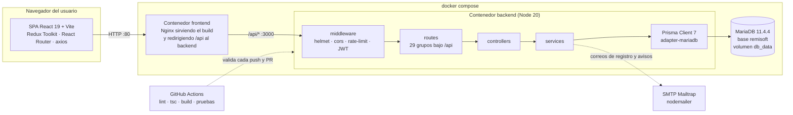

**Decisiones que muestra el diagrama**

- El navegador habla con **un solo origen**: Nginx entrega el SPA y hace de proxy hacia el backend, por lo que no hay CORS en producción y no se expone la API directamente.
- El backend **no guarda estado de sesión**: el JWT viaja en la petición y `requireAuth` lo valida en cada ruta.
- El único servicio con volumen persistente es la base de datos; los contenedores de aplicación son desechables.
- El correo sale por SMTP externo (Mailtrap en desarrollo). Si el SMTP falla, el registro de usuarios se degrada, pero el resto del sistema sigue operando.

---

## 2. Arquitectura de capas del backend

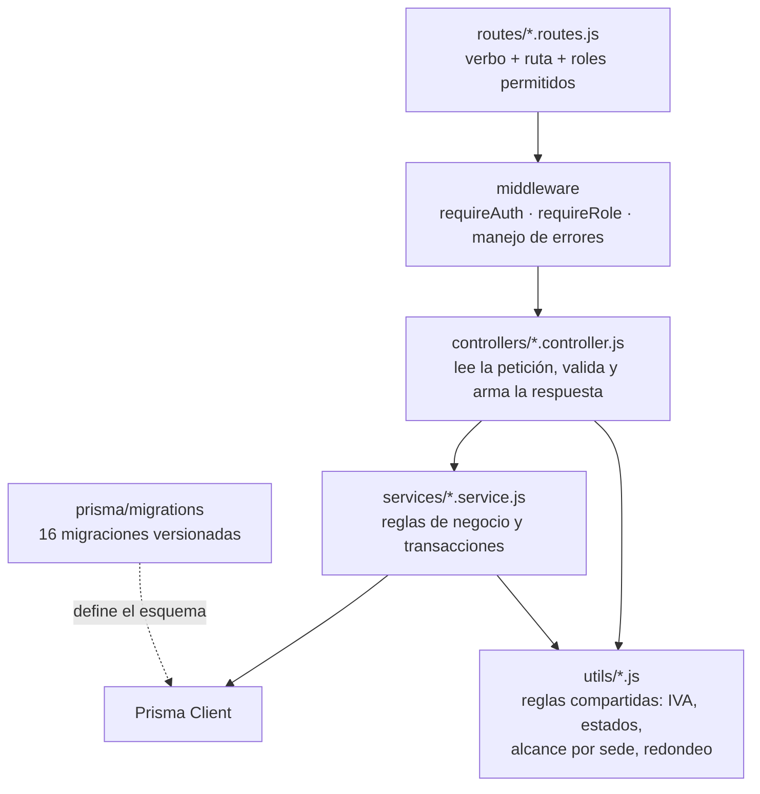

**Regla de dependencia:** las flechas apuntan siempre hacia dentro. `routes` no conoce Prisma; `controllers` no escriben SQL; `services` no leen `req` ni `res`. Esto es lo que permite que las pruebas de `services` corran sin levantar el servidor HTTP.

Distribución real de los 29 grupos de rutas por dominio:

| Dominio | Prefijo | Responsabilidad |
|---|---|---|
| Identidad | `/api/auth` | login, solicitud de registro, `me`, logout |
| Personal | `/api/usuarios` | alta y edición de empleados, roles, ocultamiento |
| Salón | `/api/salon` | mesas, carta, pedidos, rondas, cuenta |
| Cocina | `/api/cocina` | comandas, historial, avance de ítems |
| Cobro | `/api/cobro` | pendientes, cerrar y dividir cuenta, pagar partes |
| Domicilios | `/api/domicilios` | reparto y resumen del día |
| Inventario | `/api/inventario` | stock, alertas, ajustes |
| Compras | `/api/proveedores`, `/api/ordenes-compra` | proveedores y órdenes de compra |
| Analítica | `/api/reportes`, `/api/finanzas` | indicadores, exportación a Excel |
| Soporte | `/api/ia`, `/api/health`, `/api/monitoreo` | sugerencias, salud del servicio |

---

## 3. Modelo entidad-relación

El esquema completo son **36 tablas de negocio**. Para que el MER sea legible se divide en seis
dominios; las líneas punteadas indican relaciones que cruzan de un diagrama a otro.

### 3.1 Núcleo multisede: usuarios, roles y sedes

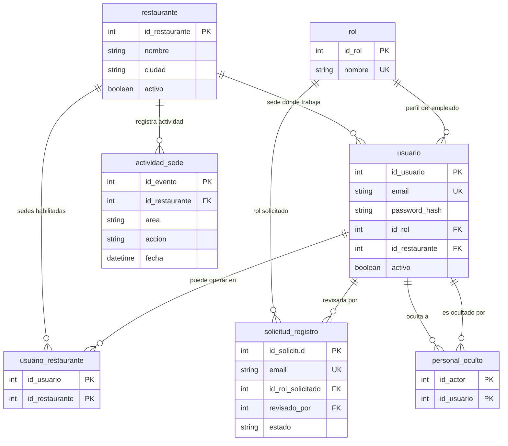

Los seis roles del sistema viven en la tabla `rol`: `SUPERADMIN`, `GERENTE`, `CAJERO`,
`MESERO`, `COCINERO` y `REPARTIDOR` (el rol 6 se agregó en la migración
`20261121120000_rol_cocinero`). `usuario_restaurante` es la tabla puente que habilita a un
empleado en varias sedes; `usuario.id_restaurante` es su sede por defecto.

### 3.2 Salón, pedidos y detalle

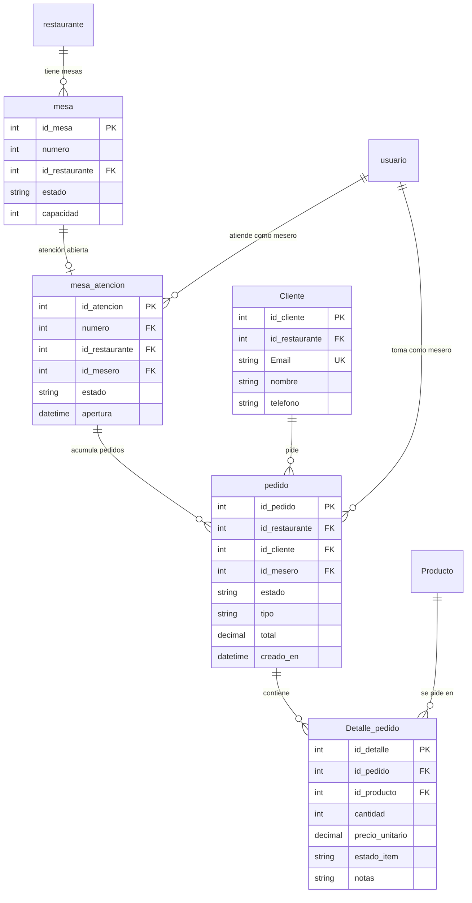

Notas de diseño:

- `mesa` se identifica por la pareja `(numero, id_restaurante)`, así que el número de mesa
  puede repetirse entre sedes. `mesa_atencion` reutiliza esa llave compuesta.
- El estado del pedido **no se edita a mano**: se deriva de los estados de sus ítems
  (`estadoSegunItems` en `backend/src/utils/salon.js`). Ver la máquina de estados en la sección 6.
- `Detalle_pedido.estado_item` es el estado del plato, el que ve la cocina.

### 3.3 Cobro, facturación y caja

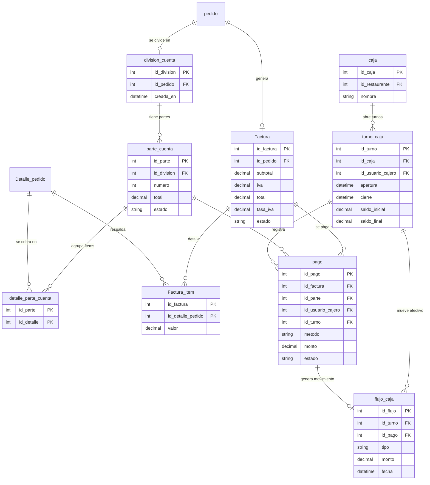

Reglas que el MER hace evidentes:

- Una cuenta se cierra de dos maneras excluyentes: **factura completa** (`Factura` 1:1 con `pedido`)
  o **dividida en partes** (`division_cuenta` 1:1 con `pedido`, con N `parte_cuenta`).
- Un `pago` cuelga de la factura y, si la cuenta se dividió, también de una parte. El índice
  `pago_ibfk_parte` permite saber qué parte quedó saldada.
- `Factura.tasa_iva` guarda la tasa aplicada en el momento del cobro (hoy 19 %), de modo que un
  cambio futuro de IVA no reescribe el histórico.

### 3.4 Inventario, recetas y compras

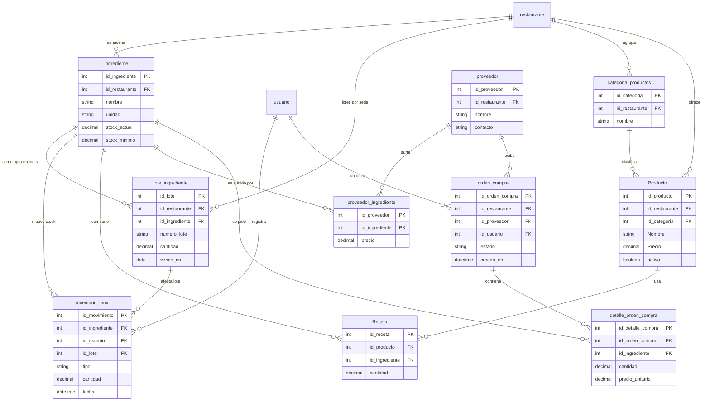

El descuento de stock ocurre **dentro de la transacción del pedido**: `salon.service.js` llama a
`calcularRequerimientos` y `bloquearIngredientes` antes de confirmar, y al anular un pedido devuelve
exactamente lo descontado comparando con los movimientos reales, no con una receta reconstruida.

### 3.5 Domicilios

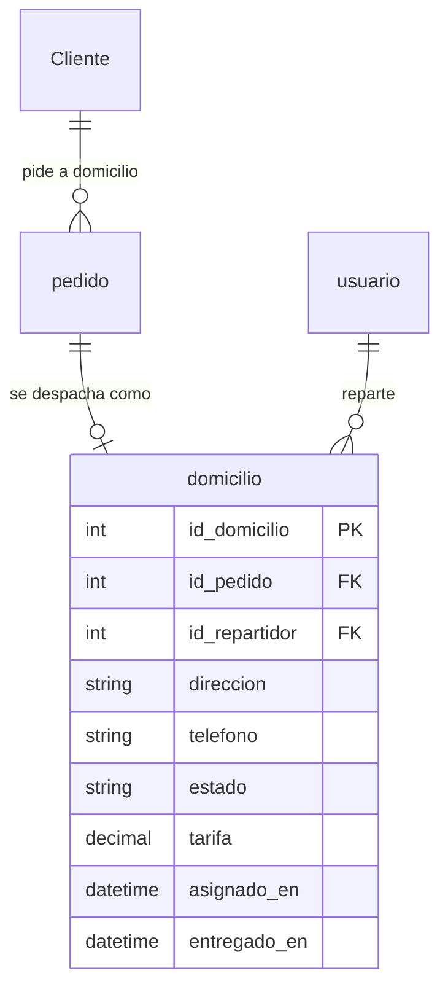

`id_repartidor` apunta a `usuario.id_usuario`: el reparto lo hace personal con rol `REPARTIDOR`,
no una entidad aparte.

### 3.6 Módulo de sugerencias (IA)

```mermaid
erDiagram
  restaurante ||--o{ IA : "consulta"
  IA ||--o{ IA_PRODUCTO : "sugiere"
  Producto ||--o{ IA_PRODUCTO : "es sugerido"
  IA ||--o{ IA_INGREDIENTE : "considera"
  Ingrediente ||--o{ IA_INGREDIENTE : "se considera"

  IA {
    int id_IA PK
    int id_restaurante FK
    string tipo
    string pregunta
    text respuesta
    datetime creada_en
  }
  IA_PRODUCTO {
    int id_IA_producto PK
    int id_IA FK
    int id_producto FK
    decimal puntaje
  }
  IA_INGREDIENTE {
    int id_IA_ingrediente PK
    int id_IA FK
    int id_ingrediente FK
    decimal puntaje
  }
```

### 3.7 Tablas de infraestructura (fuera del dominio)

No son parte del negocio y no se modelan como entidades: `cache`, `cache_locks`, `sessions`,
`jobs`, `job_batches`, `failed_jobs`, `migrations`, `password_reset_tokens`, `users` y
`personal_access_tokens`. Se conservan por compatibilidad con la primera versión del proyecto
escrita en Laravel; el backend actual usa Prisma y JWT, por lo que `sessions`,
`personal_access_tokens` y `users` están en desuso.

### 3.8 Diccionario de tablas

| # | Tabla | Módulo | Propósito |
|---|---|---|---|
| 1 | `restaurante` | Núcleo | Sede o sucursal; raíz del aislamiento multisede |
| 2 | `rol` | Núcleo | Los seis perfiles del sistema |
| 3 | `usuario` | Núcleo | Empleado o administrador, con rol y sede |
| 4 | `usuario_restaurante` | Núcleo | Puente de acceso a varias sedes |
| 5 | `solicitud_registro` | Núcleo | Alta de personal pendiente de aprobación |
| 6 | `personal_oculto` | Núcleo | Ocultamiento de un empleado por otro (moderación) |
| 7 | `actividad_sede` | Auditoría | Bitácora de eventos por sede |
| 8 | `contexto_actividad` | Auditoría | Contexto técnico del evento (conexión, área) |
| 9 | `Cliente` | Salón | Cliente de la sede, único por correo |
| 10 | `mesa` | Salón | Mesa física de la sede |
| 11 | `mesa_atencion` | Salón | Atención abierta de una mesa y su mesero |
| 12 | `pedido` | Salón | Pedido con su estado derivado y total |
| 13 | `Detalle_pedido` | Salón | Ítem del pedido con estado de cocina |
| 14 | `categoria_productos` | Carta | Agrupación del menú por sede |
| 15 | `Producto` | Carta | Plato o bebida que se vende |
| 16 | `Ingrediente` | Inventario | Insumo con stock y mínimo |
| 17 | `lote_ingrediente` | Inventario | Lote con vencimiento |
| 18 | `inventario_mov` | Inventario | Entrada, salida, ajuste o merma |
| 19 | `Receta` | Inventario | Insumos que consume cada producto |
| 20 | `proveedor` | Compras | Proveedor de la sede |
| 21 | `proveedor_ingrediente` | Compras | Catálogo de precios por proveedor |
| 22 | `orden_compra` | Compras | Orden emitida a un proveedor |
| 23 | `detalle_orden_compra` | Compras | Líneas de la orden |
| 24 | `Factura` | Cobro | Documento de venta del pedido |
| 25 | `Factura_item` | Cobro | Respaldo del ítem facturado |
| 26 | `division_cuenta` | Cobro | Cabecera de cuenta dividida |
| 27 | `parte_cuenta` | Cobro | Cada parte que paga un comensal |
| 28 | `detalle_parte_cuenta` | Cobro | Ítems asignados a cada parte |
| 29 | `pago` | Caja | Movimiento de cobro con método y cajero |
| 30 | `caja` | Caja | Caja física de la sede |
| 31 | `turno_caja` | Caja | Turno abierto por un cajero |
| 32 | `flujo_caja` | Caja | Ingresos y egresos del turno |
| 33 | `domicilio` | Domicilios | Despacho con repartidor y tarifa |
| 34 | `IA` | Sugerencias | Consulta registrada al módulo de sugerencias |
| 35 | `IA_PRODUCTO` | Sugerencias | Productos sugeridos por consulta |
| 36 | `IA_INGREDIENTE` | Sugerencias | Insumos considerados por consulta |

Además, la base incluye **7 vistas y 5 procedimientos almacenados** en `database/` para reportes
consolidados; se consultan desde `reportes` y `finanzas` y no se modelan aquí porque no aportan
reglas nuevas.

---

## 4. Modelo de clases del dominio

Vista de objetos del negocio, independiente del motor de base de datos. Las multiplicidades
describen lo que el sistema realmente permite.

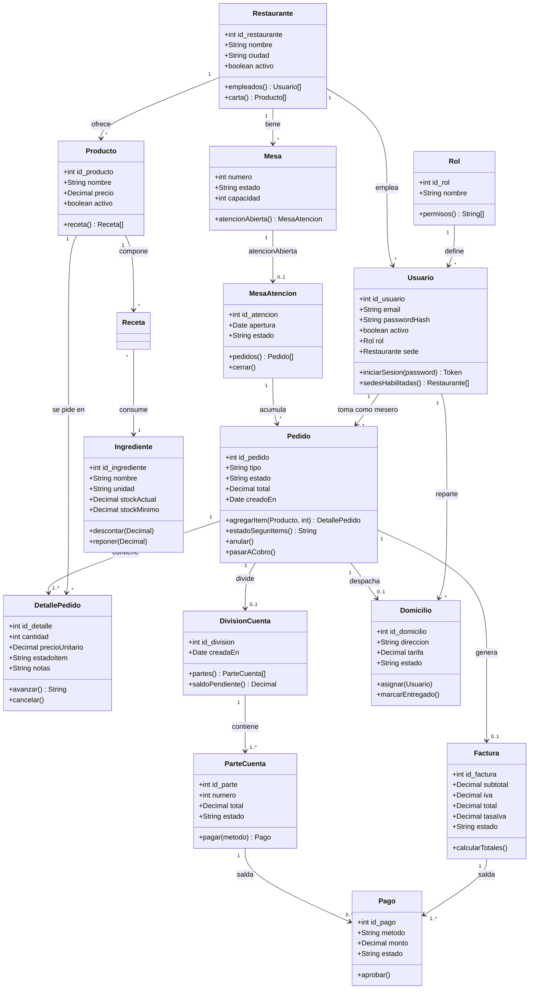

**Por qué estas clases y no las 36 tablas.** Las tablas de infraestructura no son objetos del
negocio; las de auditoría (`actividad_sede`, `inventario_mov`) son registros inmutables, no
entidades con comportamiento. Quedan como eventos, no como clases.

---

## 5. Casos de uso

### 5.1 Mapa general por actor

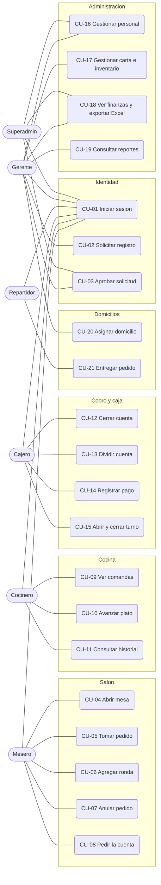

### 5.2 Caso de uso detallado: dividir la cuenta (el de mayor riesgo)

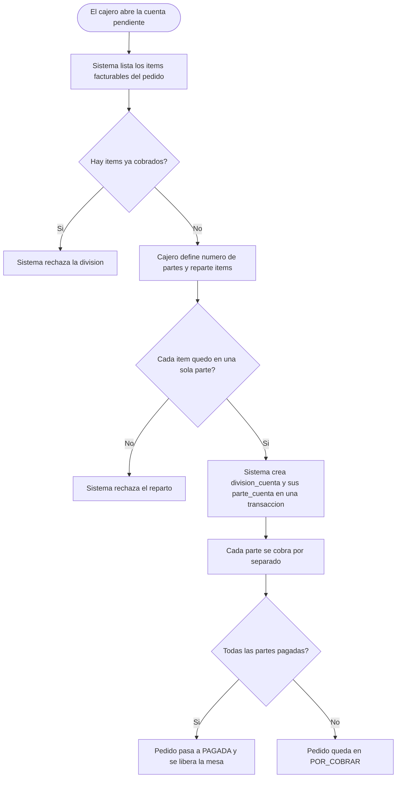

---

## 6. Máquinas de estado

### 6.1 Estado del pedido

El estado del pedido es **derivado**: lo calcula `estadoSegunItems` a partir de los ítems, salvo en
el cobro (`POR_COBRAR`, `PAGADA`) y en la anulación (`CANCELADO`), que se fijan explícitamente.

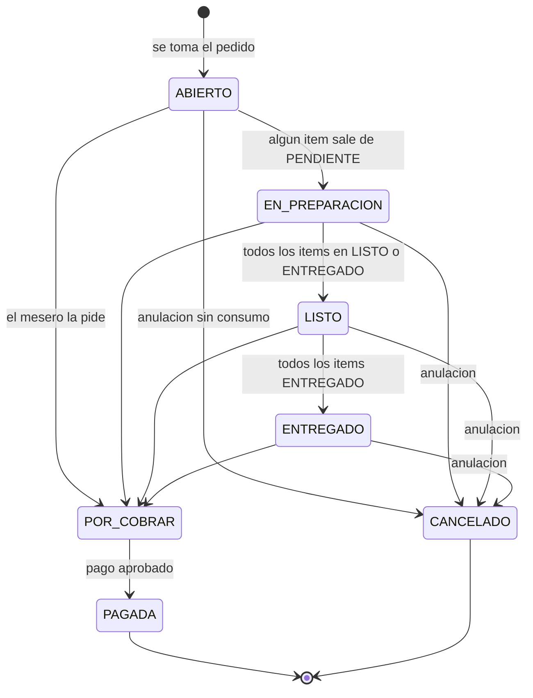

Reglas asociadas a la máquina:

1. Solo se modifica un pedido cuyo estado esté en `ESTADOS_EN_MESA`
   (`ABIERTO`, `EN_PROCESO`, `EN_PREPARACION`, `LISTO`, `ENTREGADO`, `POR_COBRAR`).
2. Un pedido en `POR_COBRAR` ya no admite cambios de ítems; ahí empieza el cobro.
3. Si la factura está sellada (`consumoSellado`), el pedido no se toca.
4. La anulación solo procede si ningún ítem salió de `PENDIENTE` o si el consumo aún se puede revertir.

### 6.2 Estado del ítem (lo que ve la cocina)

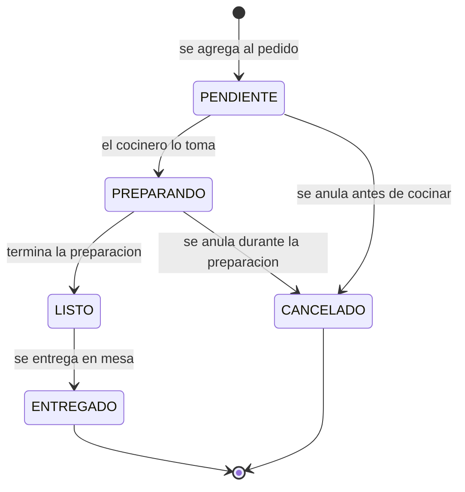

El avance es estrictamente secuencial: `PATCH /api/cocina/items/:id/avanzar` solo acepta el estado
inmediatamente siguiente. Si el plato cambió mientras el cocinero tenía la pantalla abierta, la API
responde **409** con el mensaje *"El plato cambió de estado. Actualiza la comanda."* y obliga a
refrescar. Es la protección contra dos cocineros avanzando el mismo plato.

### 6.3 Estado de la atención de mesa

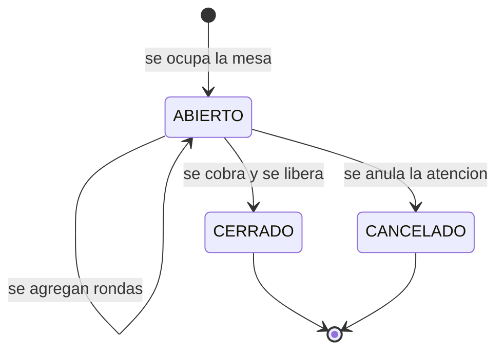

---

## 7. Qué falta y qué queda fuera

| Tema | Estado | Motivo |
|---|---|---|
| MER físico con tipos SQL exactos | Fuera | Se genera con `prisma migrate` y vive en `backend/prisma/migrations/`; duplicarlo aquí lo desincronizaría |
| Diagrama de componentes por contenedor | Incluido (§1) | Cubre el criterio 5 |
| Diagrama de clases del frontend | Fuera | El frontend es funcional (componentes y `slices` de Redux); el modelado de dominio vive en el backend |
| Prototipo IoT | Pendiente | Criterio 6 de la checklist; no existe implementación que modelar |
| Modelo de datos del módulo IA | Incluido (§3.6) | Refleja las tres tablas reales, sin inventar un servicio externo |

**Convención de nombres.** Las tablas conservan los nombres originales del esquema
(`Detalle_pedido`, `Factura_item`, `categoria_productos`), que mezclan mayúsculas y minúsculas
porque provienen de la primera versión del proyecto. No se renombraron para no romper las
migraciones ni las consultas existentes; en el código se accede a ellas a través de Prisma, que
respeta esos nombres.
