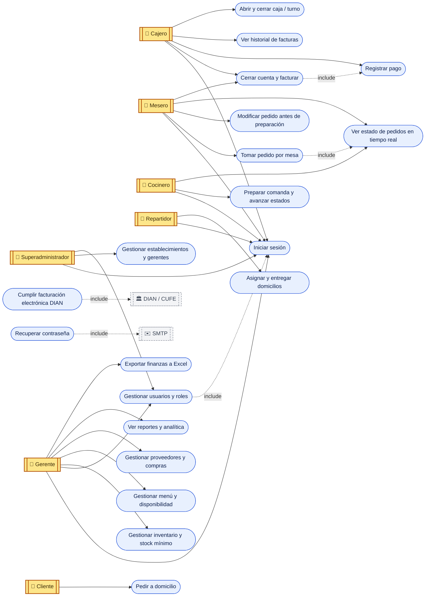
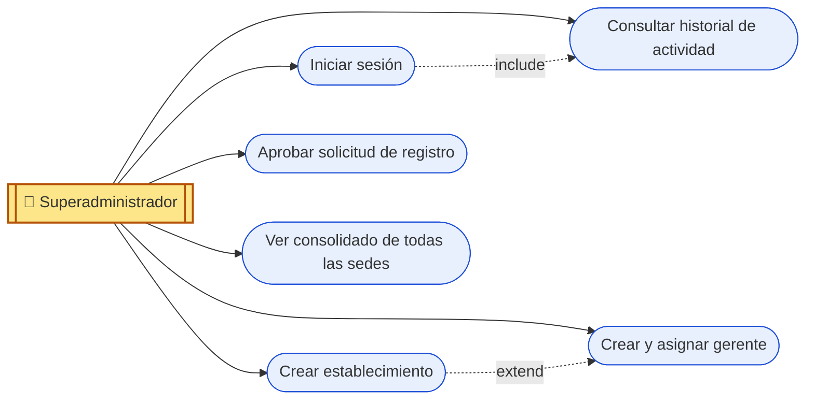
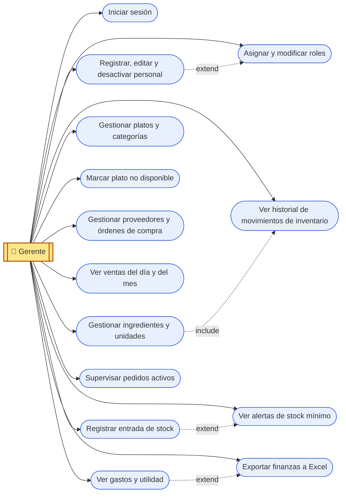
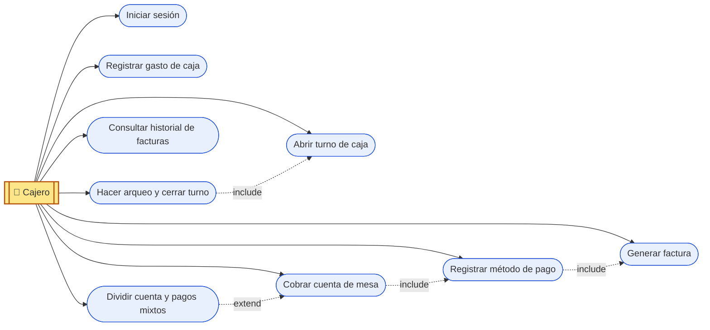
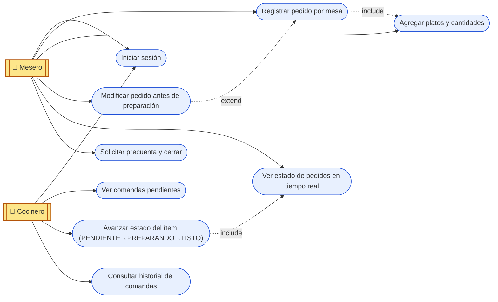
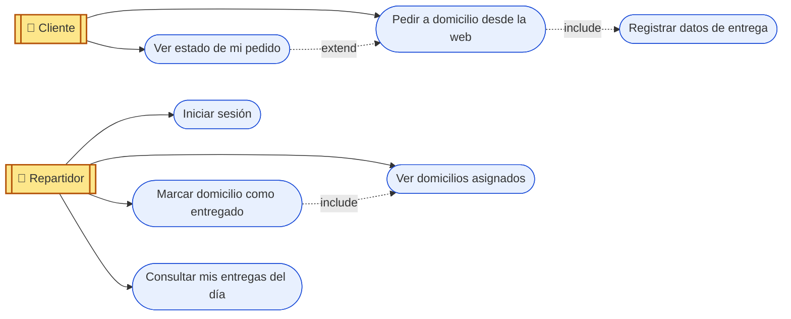

# Diagramas de casos de uso — RemiSoft

Actores del sistema (roles reales del repositorio, `backend/prisma/schema.prisma` → tabla `rol`):

| Actor | Descripción | Alcance |
|---|---|---|
| **Superadministrador** | Dueño de la cadena. Crea restaurantes y gerentes, ve todos los establecimientos. | Global |
| **Gerente** | Administra un establecimiento: personal, menú, inventario, proveedores, caja y reportes. | Su sede |
| **Cajero** | Cobra, factura, maneja caja y turnos. | Su sede |
| **Mesero** | Toma pedidos por mesa, consulta estado y cierra cuentas. | Su sede |
| **Cocinero** | Ve comandas y avanza el estado de cada ítem. | Cocina |
| **Repartidor** | Recibe domicilios asignados y reporta entregas. | Sus domicilios |
| **Cliente** | Pide a domicilio desde la web pública. | Sin sesión |
| *(Sistemas externos)* | SMTP (recuperación de contraseña), DIAN/CUFE *(no implementado)*, pasarela de pagos *(no implementada)*. | — |

Convenciones: `<<include>>` = obligatorio dentro del caso base; `<<extend>>` = opcional o condicional.

Los endpoints citados en la trazabilidad se verificaron uno por uno contra `backend/src/app.js` y
`backend/src/routes/` de la rama `develop` (29 grupos de rutas montados).

---

## 1. Contexto general (todos los actores)

---

## 2. Superadministrador

---

## 3. Gerente

---

## 4. Cajero

---

## 5. Mesero y Cocinero

---

## 6. Repartidor y Cliente

---

## 7. Trazabilidad caso de uso → historia de usuario → RF

| Caso de uso | HU | RF | Estado en el código |
|---|---|---|---|
| Iniciar sesión | HU-003 | RF-001 | `POST /api/auth/login`, `middleware/auth.js` |
| Gestionar usuarios y roles | HU-001, HU-002, HU-004 | RF-001 | `/api/usuarios`, `/api/roles`, `middleware/requireRole.js` |
| Recuperar contraseña | HU-005 | RF-001 | `/api/auth/send-reset-link`, `/api/auth/reset-password` + SMTP |
| Tomar pedido por mesa | HU-006 | RF-002 | `POST /api/salon/pedidos`, `PATCH /api/salon/mesas/:numero/estado`, `/api/mesas` |
| Modificar pedido antes de preparación | HU-007 | RF-002 | `PUT /api/salon/pedidos/:id` (solo si el pedido está `ABIERTO`) |
| Ver estado en tiempo real | HU-008, HU-010 | RF-002 | `GET /api/salon` (tablero), `GET /api/cocina/comandas`, campanita del header |
| Preparar comanda y avanzar estados | HU-008 | RF-002 | `GET /api/cocina/comandas`, `PATCH /api/cocina/items/:id/avanzar`, `GET /api/cocina/historial` |
| Cerrar cuenta y facturar | HU-009, HU-011 | RF-002, RF-003 | `GET /api/cobro/pendientes`, `POST /api/cobro/cerrar-cuenta`, `/api/facturas` |
| Registrar método de pago | HU-012 | RF-003 | `POST /api/cobro/cerrar-cuenta` (efectivo, tarjeta, PSE, NEQUI, DAVIPLATA, mixto) |
| Historial de facturas | HU-013 | RF-003 | `/api/facturas` |
| Cumplir DIAN/CUFE | HU-014 | RF-003 | **No implementado** (sin CUFE en el servicio de facturación) |
| Inventario, stock y alertas | HU-015 a HU-018 | RF-004 | `GET /api/inventario`, `GET /api/inventario/alertas/stock-bajo`, `POST /api/inventario/ajuste` |
| Menú y disponibilidad | HU-023 a HU-026 | RF-006 | `/api/productos`, `/api/categorias` |
| Domicilios | HU-019 a HU-022 | RF-005 | `POST /api/domicilios`, `PUT /api/domicilios/:id`, `GET /api/domicilios/resumen`, rol REPARTIDOR |
| Reportes y analítica | HU-027, HU-029 | RF-007 | `GET /api/reportes` (ventas diarias, pedidos activos, gastos del mes, tendencia) |
| Sugerencias con IA | HU-028, HU-030 | RF-007 | `/api/ia` (`GET` y `POST`) — solo **registra** predicciones; no genera sugerencias |
| Caja y turnos | — (soporte de HU-009) | RF-003 | `/api/cajas`, `/api/turnos` (apertura, cierre, arqueo, gastos) |
| Dividir cuenta y pagos mixtos | — (extiende HU-009) | RF-003 | `POST /api/cobro/dividir-cuenta`, `POST /api/cobro/partes/:idParte/pagar` |
| Exportar finanzas a Excel | — (soporte de HU-027) | RF-007 | `frontend/src/utils/excel.ts` + botón en Gerente → Finanzas |
