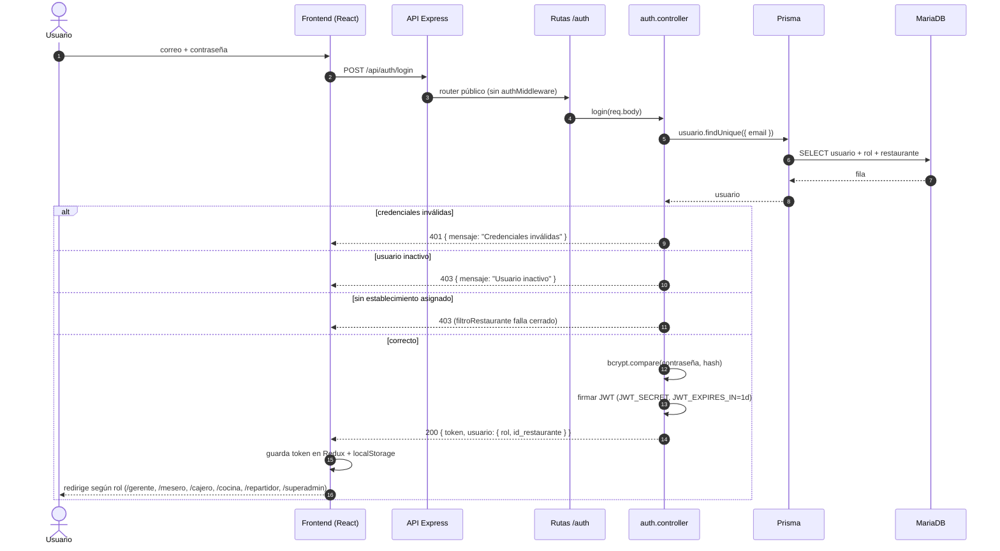
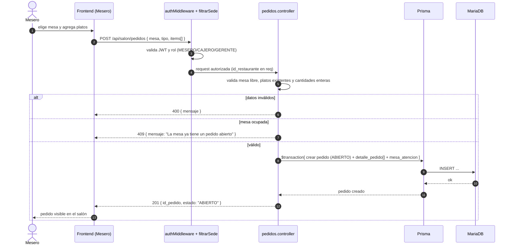
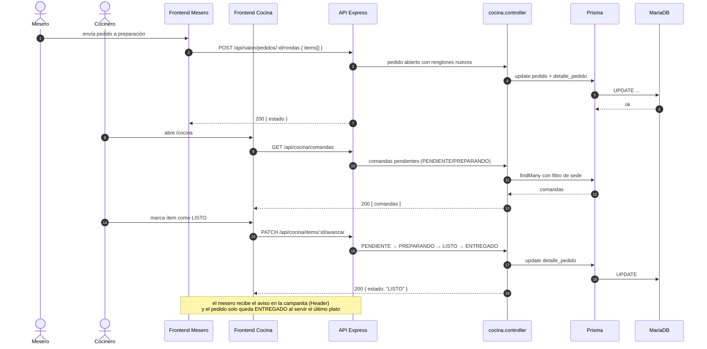
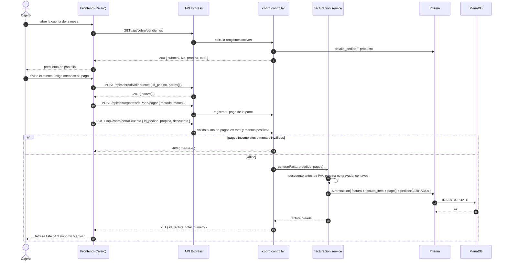
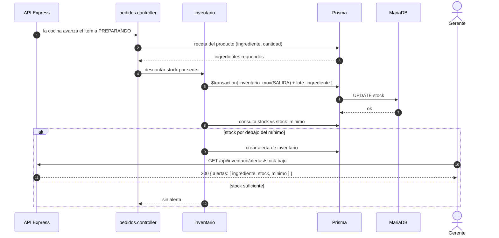
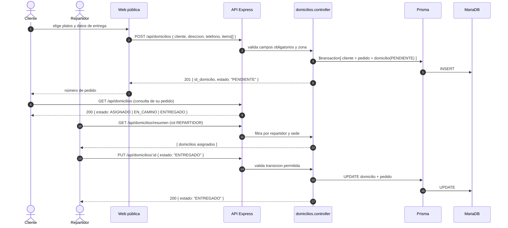
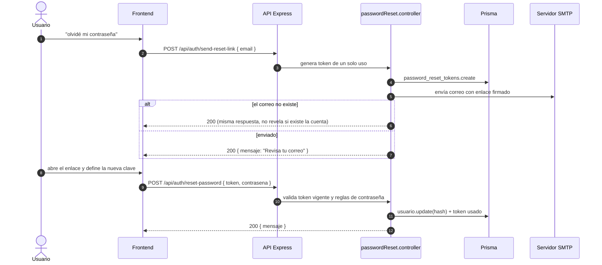
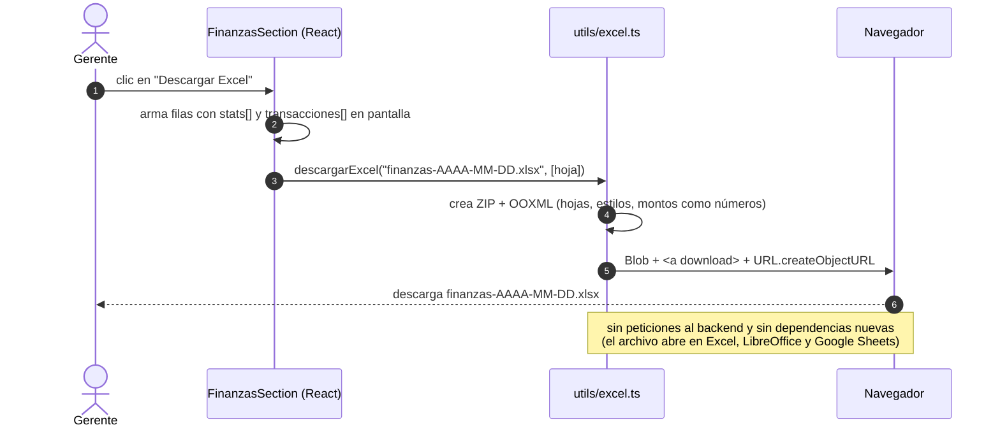

# Diagramas de secuencia — RemiSoft

Flujos tomados del código real: rutas montadas en `backend/src/app.js`, controladores en
`backend/src/controllers/`, middlewares en `backend/src/middleware/`. Todos los endpoints van precedidos
por `/api` y pasan por `authMiddleware` (excepto login, registro y recuperación de contraseña).

Endpoints verificados uno por uno contra `backend/src/app.js` y `backend/src/routes/*.routes.js` de la
rama `develop`.

Middlewares que aparecen:
- `authMiddleware` — verifica el JWT y deja el usuario en `req.usuario`.
- `requireRole(...)` — autoriza por rol (403 si no corresponde).
- `filtroRestaurante` — inyecta el `id_restaurante` del usuario; falla cerrado (403) si el usuario no tiene sede.
- `errorHandler` — traduce excepciones a respuestas JSON uniformes.

---

## 1. Inicio de sesión y autorización por rol

---

## 2. Tomar un pedido por mesa

---

## 3. Comanda de cocina y avance de estados

---

## 4. Cerrar cuenta y facturar con pagos mixtos

---

## 5. Descuento automático de inventario y alerta de stock mínimo

---

## 6. Pedido a domicilio y asignación al repartidor

---

## 7. Recuperación de contraseña (SMTP)

Reglas de contraseña aplicadas (`usuarios.controller.js`): mínimo 8 caracteres, con minúscula,
mayúscula, dígito y carácter especial.

---

## 8. Exportar las finanzas del mes a Excel (frontend, sin backend)

