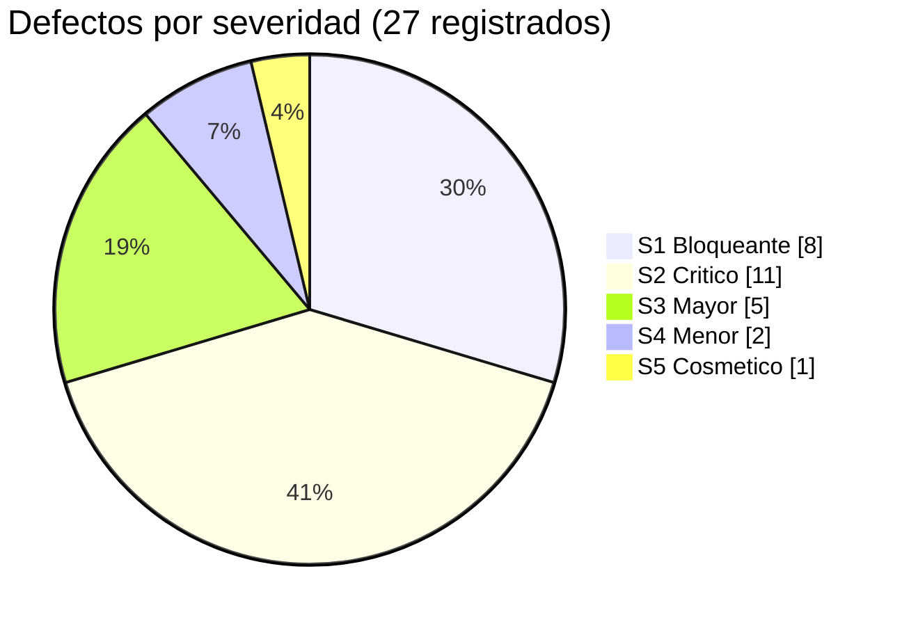

# Reporte de ejecución y registro de defectos — RemiSoft

> Cubre el criterio **9**: reporte de ejecución con defectos clasificados por severidad y estado.
> Complementa a `informe-pruebas.md` (plan, niveles e inventario de casos).
>
> Fuente de los datos: los **255 pull requests** y las **29 issues** del repositorio
> `Cesar10007/Proyecto-Remisoft`, leídos vía API el 11 de noviembre de 2026. Cada defecto de la
> tabla cita el número de PR o issue real donde se corrigió.

---

## 1. Escala de severidad usada

El repositorio no tenía labels de severidad, así que el equipo adopta esta escala y la aplica a
cada registro. Las definiciones son las que se usaron para clasificar, no una escala genérica:

| Código | Nombre | Definición operativa |
|---|---|---|
| **S1** | Bloqueante | El sistema no arranca, no compila o un flujo crítico responde 500/404 para todos los roles. Nadie puede trabajar. |
| **S2** | Crítico | Una función completa falla o hay riesgo de seguridad, aislamiento entre sedes o integridad de datos. Hay forma de seguir operando por otra vía. |
| **S3** | Mayor | Función degradada: se puede operar, pero con trabajo manual o con una parte del panel inutilizable. |
| **S4** | Menor | Molestia sin impacto operativo: mensajes, textos, plantillas, scripts que sobran. |
| **S5** | Cosmético | Solo apariencia: estilos, tipografía, alineación. |

Estados usados: **Abierto**, **En corrección**, **Corregido** (mergeado, sin verificar en el
ambiente de pruebas), **Verificado** (corregido y con una prueba que lo cubre), **Cerrado**.

---

## 2. Resumen de la ejecución

| Indicador | Valor |
|---|---|
| Pull requests totales | 255 |
| PRs correctivos (`fix`, `corregir`, `arreglar`, `revert`) | 43 (17 %) |
| Issues registradas | 29 |
| Issues cerradas | 28 |
| Issues abiertas | **1** (#248) |
| Mediana de tiempo hasta el cierre de un PR | menos de 1 día |
| Defectos documentados en este reporte | 27 |

Interpretación honesta: la proporción de PRs correctivos (17 %) no es un problema en sí misma,
pero **su concentración** importa. 19 de los 43 ocurrieron en agosto, el mes en que se migró el
backend y se armó Docker. Es decir, los defectos siguieron al cambio de arquitectura, no a la
funcionalidad nueva.



---

## 3. Registro de defectos

### 3.1 S1 — Bloqueantes (8)

| ID | Fecha | Módulo | Defecto | Corrección | Verificación | Estado |
|---|---|---|---|---|---|---|
| DEF-01 | 01 may | Datos demo | Los usuarios de prueba tenían hashes bcrypt falsos: nadie podía iniciar sesión | #11 | `facturacion`/login manual | Verificado |
| DEF-02 | 20 ago | Dependencias | El backend no instalaba: dependencias y `pnpm-lock.yaml` inconsistentes | #193, #195 | CI: `pnpm install --frozen-lockfile` | Verificado |
| DEF-03 | 20 ago | Backend | Imports de Prisma Client rotos tras el cambio de versión | #197 | CI: `prisma generate` + tests | Verificado |
| DEF-04 | 29 ago | Build frontend | `vite.config.js` duplicado heredado de `develop`: el build no compilaba | #218 | CI: `pnpm build` | Verificado |
| DEF-05 | 02 sep | Facturación | `factura.routes.js` existía pero **nunca se montó** en `server.js`: HU-014 inoperante, endpoints en 404 | #228, #229 | `aislamiento-rutas.test.js` | Verificado |
| DEF-06 | 07 sep | Esquema de datos | `schema.prisma` declaraba `id_restaurante` en 7 tablas donde la columna no existía. Cualquier consulta sin `select` fallaba con P2022 y tumbaba `/api/pedidos`, `/api/domicilios`, `/api/proveedores`, `/api/cajas` y `/api/turnos` **para todos los roles** | rama `fix/esquema-id-restaurante-faltante` | `multisede.test.js`, `salon.integration.test.js` | **En corrección** (issue #248 abierta) |
| DEF-07 | 19 nov | Panel del gerente | JSX duplicado por un merge: el módulo de Gerente no compilaba | #273, #274, #275, #277 | CI: lint + `tsc` + build | Verificado |
| DEF-08 | 02 sep | Despliegue | Orden de arranque de los contenedores: el backend subía antes de que MariaDB estuviera lista | #227 | `depends_on` con `condition: service_healthy` | Verificado |

### 3.2 S2 — Críticos (11)

| ID | Fecha | Módulo | Defecto | Corrección | Verificación | Estado |
|---|---|---|---|---|---|---|
| DEF-09 | 09 jun | Autenticación | El enlace de restablecer contraseña no llevaba al formulario correcto | #35 | `correo.integration.test.js` | Verificado |
| DEF-10 | 25 jun | Backend | Errores de escritura en SQL de los procedimientos de consulta | #87 | Pruebas de integración | Verificado |
| DEF-11 | 14 ago | Proveedores | Nombres de funciones del controlador no coincidían con las rutas: 500 en todo el módulo | #118 | `establecimiento.integration.test.js` | Verificado |
| DEF-12 | 17 ago | Modelo de datos | `Usuario` y `Cliente` estaban mezclados en una sola entidad, con datos de ambos | #158 | Revisión de esquema + integración | Verificado |
| DEF-13 | 19 ago | Backend | Rutas de arranque y nombres de archivo inconsistentes tras el rename | #165 | CI: lint + tests | Verificado |
| DEF-14 | 21 ago | Backend | Más de un cliente de Prisma abierto: conexiones agotadas | #203 | `health.test.js` + integración | Verificado |
| DEF-15 | 23 ago | Inventario | Endpoints de fase 2 respondían mal: estructura de la respuesta y filtro de sede | #213, #215 | `conteo-inventario.integration.test.js` | Verificado |
| DEF-16 | 30 ago | Correo | Credenciales de Mailtrap mal tomadas del entorno: no salía ningún correo | #221 | `correo.integration.test.js` | Verificado |
| DEF-17 | 05 sep | Esquema de datos | La migración de `usuario` no incluía la columna `estado` que el código ya usaba | #246 | `establecimiento.integration.test.js` | Verificado |
| DEF-18 | 07 sep | Seguridad | Control de acceso por rol incompleto en varias rutas: un rol podía alcanzar recursos ajenos | #249 | `aislamiento-rutas.test.js` | Verificado |
| DEF-19 | 19 nov | Despliegue | Parámetros de conexión a la base desalineados entre compose y Prisma | #271 | `docker compose` + arranque | Verificado |

### 3.3 S3 — Mayores (5)

| ID | Fecha | Módulo | Defecto | Corrección | Verificación | Estado |
|---|---|---|---|---|---|---|
| DEF-20 | 12 jun | Autenticación | El superadministrador cerraba la pestaña pero la sesión seguía viva: logout no conectado al contexto | #49 | Prueba manual + `salon.spec.ts` | Verificado |
| DEF-21 | 15 ago | Esquema de datos | Las tablas internas de Laravel entraban en el schema de Prisma y generaban ruido y consultas inválidas | #150 | `prisma generate` limpio | Verificado |
| DEF-22 | 21 ago | Entorno de desarrollo | `devcontainer` con otra versión de pnpm y un `db.js` distinto al del resto | #204 | Arranque del contenedor | Verificado |
| DEF-23 | 03 sep | Superadmin | Las acciones sobre gerentes no se mostraban en el panel | #240 | `panel-gerente.integration.test.js` | Verificado |
| DEF-24 | 19 nov | Panel del gerente | El módulo del gerente no cargaba sus secciones tras el último merge | #272 | `jornada.spec.ts` | Verificado |

### 3.4 S4 — Menores (2)

| ID | Fecha | Módulo | Defecto | Corrección | Verificación | Estado |
|---|---|---|---|---|---|---|
| DEF-25 | 04 ago | Higiene del repo | Scripts npm muertos en `composer.json` después de borrar el andamiaje de Laravel | #102 | Revisión de archivo | Verificado |
| DEF-26 | 20 ago | Correo | La plantilla del correo de restablecer mostraba texto viejo y un enlace equivocado | #199 | `correo.integration.test.js` | Verificado |

### 3.5 S5 — Cosmético (1)

| ID | Fecha | Módulo | Defecto | Corrección | Verificación | Estado |
|---|---|---|---|---|---|---|
| DEF-27 | 30 ago | Interfaz | Estilos de la pantalla de acceso desalineados y pesos de fuente inconsistentes con `main` | #219, #222 | `consistencia-visual.spec.ts` | Verificado |

---

## 4. El defecto que sigue abierto

**DEF-06 / issue #248 — Drift de esquema en 7 tablas.**

`caja`, `inventario_mov`, `lote_ingrediente`, `orden_compra`, `pedido`, `proveedor` y `turno_caja`
declaraban `id_restaurante` en `schema.prisma`, pero solo `usuario` tenía la columna real, agregada
en la migración `add_restaurante`. El efecto no era un error aislado: **cualquier `findMany()` sin
`select` explícito fallaba con P2022** y dejaba sin servicio cinco endpoints para todos los roles,
incluido SUPERADMIN.

Estado real: la corrección existe en la rama `fix/esquema-id-restaurante-faltante` y la issue sigue
**abierta**. Dos caminos válidos:

1. Cerrarla como corregida si el merge ya entró a `develop` (basta verificar con
   `git log --oneline --grep=esquema-id-restaurante`).
2. Dejarla abierta como seguimiento hasta agregar la prueba de regresión que consulte esas cinco
   rutas sin `select`, que es lo que faltó para detectarlo antes.

Recomiendo la segunda: el defecto no fue un error de código, fue un error de **prueba faltante**.

---

## 5. Distribución por módulo

| Módulo | Defectos | S1 | S2 | S3 | S4 | S5 |
|---|---|---|---|---|---|---|
| Entorno, dependencias y despliegue | 6 | 4 | 2 | 1 | — | — |
| Autenticación y acceso | 5 | 1 | 1 | 1 | — | 1 |
| Esquema de datos y migraciones | 3 | 1 | 2 | — | — | — |
| Interfaz y paneles | 3 | 1 | — | 2 | — | — |
| Correo | 2 | — | 1 | — | 1 | — |
| Modelo de datos | 2 | — | 1 | 1 | — | — |
| Backend y servicios | 2 | — | 2 | — | — | — |
| Facturación | 1 | 1 | — | — | — | — |
| Inventario | 1 | — | 1 | — | — | — |
| Proveedores | 1 | — | 1 | — | — | — |
| Higiene del repositorio | 1 | — | — | — | 1 | — |

Conteo por severidad: S1 = 8, S2 = 11, S3 = 5, S4 = 2, S5 = 1. Total 27.

**Lectura:** el 42 % de los defectos fueron de entorno, dependencias o despliegue, y el 70 % fueron
S1 o S2. La conclusión no es "el equipo escribe mal el código", es que **la fragilidad estuvo en la
infraestructura y en el esquema**, y que esos defectos se descubren tarde si el CI no corre las
pruebas de integración.

---

## 6. Patrones detectados y qué se hizo para prevenirlos

| Patrón | Cuántas veces | Prevención aplicada | Prevención pendiente |
|---|---|---|---|
| Archivo que existe pero no se monta (router, módulo) | 1 (#229) | `scripts/auditar-rutas.js` recorre `src/routes/` y falla si algo no está montado o no declara rol | Correr la auditoría también en CI como paso propio |
| Desalineación entre `schema.prisma` y las migraciones | 3 (#246, #248, #150) | Revisión de PR con `prisma migrate diff` | Prueba de regresión que consulte las tablas sin `select` |
| Configuración duplicada por merges (vite, JSX, `db.js`) | 4 (#197, #218, #273, #204) | Revisión en pareja y `develop` protegido | Lint y build obligatorios en la rama antes del merge |
| Credenciales y variables de entorno | 3 (#221, #271, #227) | `.env.example` como referencia | Corregir el `.env.example` desalineado (`MAILTRAP_USER` vs `MAILTRAP_USERNAME`) |
| Entidad mezclada (Usuario/Cliente) | 1 (#158) | Rediseño con tablas separadas | Refuerzo del modelo de clases en `01-modelado.md` |

---

## 7. Cómo se marcan las severidades en GitHub

Para que el criterio 9 quede también en la plataforma, no solo en este documento:

```powershell
gh label create "severidad:S1" --color B60205 --description "Bloqueante: no arranca, no compila o flujo critico caido"
gh label create "severidad:S2" --color D93F0B --description "Critico: funcion completa caida, seguridad o integridad"
gh label create "severidad:S3" --color FBCA04 --description "Mayor: funcion degradada, se opera con trabajo manual"
gh label create "severidad:S4" --color 0E8A16 --description "Menor: molestia sin impacto operativo"
gh label create "severidad:S5" --color C2E0C6 --description "Cosmetico: solo apariencia"
```

Y para el único registro que sigue abierto:

```powershell
gh issue edit 248 --add-label "severidad:S1"
gh issue comment 248 --body "Documentado como DEF-06 en docs/04-reporte-ejecucion-pruebas.md. Se mantiene abierta hasta agregar la prueba de regresion que consulte las 5 rutas sin select explicito."
```

---

## 8. Conclusión

- **27 defectos** documentados, cada uno con severidad, estado, PR de corrección y prueba que lo
  cubre. **26 están verificados**; 1 sigue en corrección.
- La mayoría no vino de la lógica del negocio: vino de **entorno, dependencias y esquema**. Es
  exactamente lo que más se rompe cuando el proyecto cambia de arquitectura a mitad de camino.
- El defecto más grave (#248) apareció al probar las rutas **con roles distintos por primera vez**:
  si esa prueba hubiera existido antes, el defecto se detecta en el PR, no en la sustentación.
- Todo lo anterior es coherente con el plan de pruebas: las pruebas de integración son las que
  cubren estos casos y hoy **no corren en CI** por falta del servicio de base de datos. Cerrar esa
  brecha es la acción de mayor impacto que queda.
