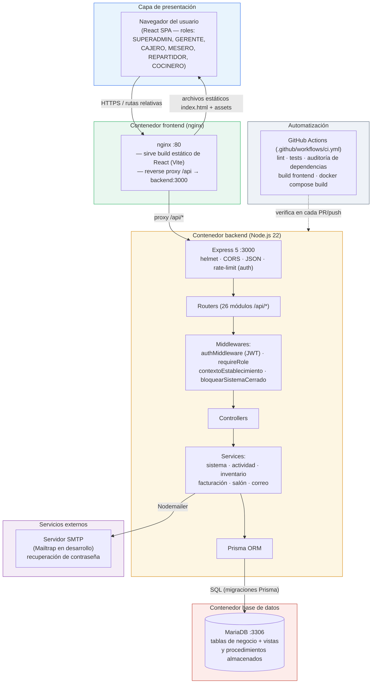
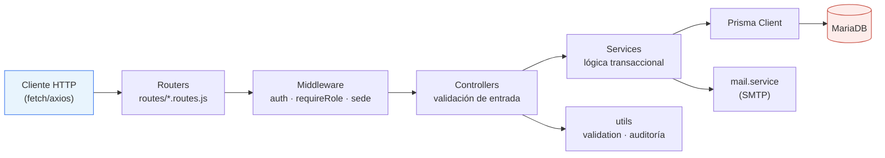

# Diagrama de arquitectura — RemiSoft

Diagrama de arquitectura del sistema **RemiSoft** (Sistema Web Inteligente para Restaurantes),
elaborado a partir del despliegue real con Docker Compose. Forma parte de la documentación
general del proyecto (checklist, criterios 1 y 5).

---

## 1. Arquitectura de despliegue (vista de componentes)



**Lectura del diagrama**

1. El **navegador** consume la SPA de React compilada. Todas las llamadas HTTP usan rutas
   relativas (`/api/...`); el navegador nunca habla directamente con la base de datos.
2. **nginx** (contenedor `frontend`) sirve los archivos estáticos y hace *reverse proxy* de
   `/api/` al servicio interno `backend:3000`. Es la única entrada pública del sistema.
3. El **backend Express** aplica una cadena de middlewares (seguridad → autenticación JWT →
   contexto de sede → autorización por rol) antes de llegar a los controllers.
4. **Prisma** es el único punto de acceso a **MariaDB** (migraciones versionadas en
   `backend/prisma/migrations`). La BD también expone vistas y procedimientos almacenados
   (`database/vistas`, `database/procedimientos`) para reportes y operaciones atómicas.
5. El **correo** (Nodemailer → SMTP) se usa para recuperación de contraseña; las credenciales
   viven únicamente en variables de entorno.
6. **GitHub Actions** ejecuta lint, tests automatizados, auditoría de dependencias y la
   construcción de imágenes Docker en cada pull request y push.

---

## 2. Arquitectura lógica (capas del backend)



| Capa | Responsabilidad | Regla |
|------|-----------------|-------|
| Routers | Mapear método + ruta a un handler y aplicar `requireRole` | Sin lógica de negocio |
| Middleware | Autenticar JWT, resolver sede activa, bloquear sistema cerrado | 401/403/422/423 |
| Controllers | Validar y normalizar `req.body/query/params`, orquestar | Respuestas HTTP |
| Services | Transacciones Prisma, reglas de negocio, auditoría | Sin `req`/`res` |
| Prisma | Acceso a datos | Único hablante de SQL |

---

## 3. Flujo de una petición autenticada (secuencia)

```mermaid
sequenceDiagram
    autonumber
    participant U as Navegador
    participant N as nginx (:80)
    participant E as Express (:3000)
    participant M as Middlewares
    participant C as Controller
    participant S as Service
    participant B as MariaDB

    U->>N: GET /api/pedidos<br/>Authorization: Bearer &lt;JWT&gt;
    N->>E: proxy /api → backend:3000
    E->>M: authMiddleware
    M->>M: verifica firma y expiración del JWT
    alt token inválido o ausente
        M-->>U: 401 { message: "No autenticado" }
    end
    M->>M: contextoEstablecimiento<br/>req.sede = filtroRestaurante(user)
    M->>M: requireRole('SUPERADMIN','GERENTE','CAJERO','MESERO')
    alt rol no permitido
        M-->>U: 403 { message: "No tienes permisos..." }
    end
    M->>C: pedidosController.index(req, res)
    C->>S: consulta con filtro de sede
    S->>B: SELECT ... WHERE id_restaurante = ?
    B-->>S: filas
    S-->>C: datos
    C-->>U: 200 [ { id_pedido, estado, ... } ]
```

---

## 4. Vista de despliegue (Docker Compose)

| Servicio | Imagen / build | Puerto | Rol |
|----------|----------------|--------|-----|
| `mariadb` | MariaDB oficial | 3306 (interno) | Base de datos + volumen persistente |
| `backend` | `backend/Dockerfile` (Node 22 + pnpm) | 3000 (interno) | API REST Express + Prisma; aplica migraciones al arrancar |
| `frontend` | `frontend/Dockerfile` (build Vite → nginx) | 80 (publicado) | SPA estática + proxy `/api` |

- **Variables de entorno**: `.env` en la raíz (ver `.env.example` y README §Variables de entorno):
  `DB_ROOT_PASSWORD`, `JWT_SECRET`, `MAILTRAP_*`, `MAIL_FROM`, `CARGAR_DEMO`.
- **Red**: solo nginx publica puertos al exterior; backend y mariadb son internos de la red Compose.
- **Datos**: el volumen de MariaDB sobrevive a `docker compose down` (sin `-v`).

---

## 5. Decisiones de arquitectura (relación con formaciones previas)

| Decisión | Formación previa aplicada | Beneficio |
|----------|---------------------------|-----------|
| Arquitectura por capas (Router→Controller→Service→DAO) | POO y patrones (capas, singleton del Prisma client, factory de `requireRole`) | Código testeable y mantenible |
| API REST + SPA desacopladas | Bases de despliegue (cliente–servidor) | Frontend y backend evolucionan por separado |
| ORM con migraciones versionadas (Prisma) | Bases de datos (modelado relacional, integridad referencial) | Esquema reproducible, sin drift |
| Contenedores Docker Compose + nginx como entrada única | Infraestructura/despliegue | "Funciona en mi máquina" = funciona en producción |
| CI en GitHub Actions (lint, tests, build) | Calidad y aseguramiento | Integración continua real |
| Autenticación JWT + roles + auditoría transaccional | Seguridad | Trazabilidad y control de acceso por rol y sede |
