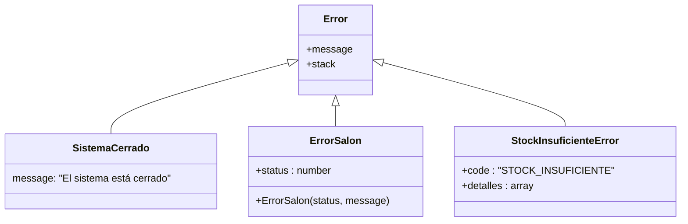
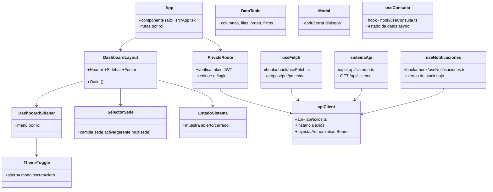

# Diagrama de clases — RemiSoft

Diagrama UML de clases del sistema, elaborado a partir del código real
(`backend/src`, `frontend/src`). Forma parte de la documentación general del proyecto
(checklist, criterio 1).

El sistema sigue una **arquitectura por capas** (Router → Middleware → Controller → Service →
Prisma/BD). Los diagramas usan notación UML en Mermaid:
`+` público, `-` privado, `«etiqueta»` estereotipo. Se muestran las clases/módulos representativos;
la tabla final enumera la totalidad de los módulos.

---

## 1. Vista general del backend (capas)

```mermaid
classDiagram
    direction TB

    class App {
        «module» src/app.js
        +configurarMiddlewares()
        +montarRutas()
        -helmet()
        -express.json()
    }
    class Server {
        «module» src/server.js
        +iniciar()
    }

    class auth {
        «middleware» middleware/auth.js
        +authMiddleware(req, res, next)
    }
    class requireRole {
        «middleware» middleware/requireRole.js
        +requireRole(...rolesPermitidos)$
    }
    class establecimiento {
        «middleware» middleware/establecimiento.js
        +contextoEstablecimiento(req, res, next)
        +bloquearSistemaCerrado(req, res, next)
    }
    class errorHandler {
        «middleware» middleware/errorHandler.js
        +errorHandler(err, req, res, next)
    }

    class authController {
        «controller» controllers/auth.controller.js
        +login(req, res)
        +me(req, res)
        +logout(req, res)
        +crearSolicitud(req, res)
    }
    class pedidosController {
        «controller» controllers/pedidos.controller.js
        +index(req, res)
        +show(req, res)
        +crear(req, res)
        +actualizar(req, res)
        +eliminar(req, res)
        -validarPedido(body, opts)
    }
    class usuariosController {
        «controller» controllers/usuarios.controller.js
        +index() +show() +crear()
        +actualizar() +cambiarEstado() +eliminar()
        +misSedes() +cambiarSede()
        +sedesDeUsuario() +asignarSedes()
    }
    class salonController {
        «controller» controllers/salon.controller.js
        +tablero(req, res)
        +carta(req, res)
        +operar(accion)
        +actualizarMesa(req, res)
    }
    class cobroController {
        «controller» controllers/cobro.controller.js
        +pendientes() +cerrarCuenta()
        +dividirCuenta() +eliminarDivision()
        +pagarParte()
    }

    class sistemaService {
        «service» services/sistema.service.js
        +pendientesDeCierre(tx, idSede)
        +cerrar/abrirSistema()
    }
    class actividadService {
        «service» services/actividad.service.js
        +escritura(actor, tarea, opts)
        +esperarCambio(req, res)
        +actividadSesion(usuario, accion)
    }
    class inventarioService {
        «service» services/inventario.service.js
        +verificarStockSuficiente(tx, items, sede)
        +registrarSalidasPorConsumo(tx, ...)
        +crearAjusteManual(tx, ...)
        +conciliarConteo(tx, ...)
    }
    class facturacionService {
        «service» services/facturacion.service.js
        +generarFactura(user, body)
        +editarFactura(user, id, body)
        +guardarConsumo(tx, pedido, ...)
    }
    class salonService {
        «service» services/salon.service.js
        +abrirMesa(user, body)
        +cambiarComanda(user, id, body, accion)
    }
    class mailService {
        «service» services/mail.service.js
        +sendPasswordResetEmail(email, token)
    }

    class validation {
        «util» utils/validation.js
        +parseId(id)$
        +validateString(value, field, max)$
        +validateEmail(value, opts)$
        +cantidadInventarioValida(valor, opts)$
    }
    class restauranteUtil {
        «util» utils/restaurante.js
        +filtroRestaurante(user)$
    }
    class auditoria {
        «util» utils/auditoria.js
        +registrarAuditoria(evento)$
    }

    class PrismaClient {
        «config» config/prisma.js
        +usuario producto pedido ...
    }

    class Error {
        «clase nativa»
    }
    class SistemaCerrado {
        «error de dominio»
    }
    class ErrorSalon {
        «error de dominio» utils/salon.js
        +status
    }
    class StockInsuficienteError {
        «error de dominio»
        +detalles
    }

    App --> auth : monta
    App --> establecimiento : monta
    App --> errorHandler : al final
    Server --> App
    authController ..> requireRole : usa
    pedidosController ..> requireRole : usa
    auth --> authController : despacha
    authController --> actividadService
    pedidosController --> inventarioService
    pedidosController --> PrismaClient
    usuariosController --> PrismaClient
    salonController --> salonService
    cobroController --> facturacionService
    salonService --> inventarioService
    facturacionService --> inventarioService
    sistemaService --> PrismaClient
    actividadService --> PrismaClient
    inventarioService --> PrismaClient
    mailService --> PrismaClient
    error ..> errorHandler : intercepta
    Error <|-- SistemaCerrado
    Error <|-- ErrorSalon
    Error <|-- StockInsuficienteError
    errorHandler --> SistemaCerrado : 423
    errorHandler --> ErrorSalon : err.status
    errorHandler --> StockInsuficienteError : 409
```

### Flujo de una petición (responsabilidades)

1. **`App`** monta la cadena: `helmet` → CORS → `express.json` → rate-limit (solo auth) →
   rutas públicas de auth → `authMiddleware` → `contextoEstablecimiento` → routers →
   404 → `errorHandler`.
2. **`requireRole(...roles)`** es una *factory*: devuelve el middleware que valida el rol del JWT
   (401 si no hay usuario, 403 si el rol no está permitido).
3. **`contextoEstablecimiento`** resuelve `req.sede = filtroRestaurante(req.user)`: el SUPERADMIN
   puede elegir sede con `?id_restaurante`; los demás usan su sede activa.
4. Los **controllers** validan entrada (helpers de `validation`) y delegan la lógica transaccional
   a los **services**, que usan `PrismaClient`.
5. Los **errores de dominio** (`SistemaCerrado`, `ErrorSalon`, `StockInsuficienteError`) suben al
   `errorHandler`, que los traduce a códigos HTTP (423 / err.status / 409).

---

## 2. Clases de error del dominio

---

## 3. Frontend (React) — componentes principales

---

## 4. Inventario de módulos backend

| Capa | Módulo | Responsabilidad |
|------|--------|-----------------|
| config | `config/prisma.js` | Cliente Prisma singleton |
| middleware | `middleware/auth.js` | Verifica JWT (`Authorization: Bearer`) |
| middleware | `middleware/requireRole.js` | Autorización por rol |
| middleware | `middleware/establecimiento.js` | Contexto de sede + bloqueo de sistema cerrado |
| middleware | `middleware/errorHandler.js` | Traducción de errores a HTTP/JSON |
| controller | `auth.controller.js` | Login, sesión, solicitud de registro |
| controller | `passwordReset.controller.js` | Recuperación de contraseña por correo |
| controller | `usuarios.controller.js` | CRUD usuarios, sedes y membresías |
| controller | `rol.controller.js` | CRUD de roles |
| controller | `solicitudRegistro.controller.js` | Aprobar/rechazar altas de personal |
| controller | `restaurantes.controller.js` | Listado de establecimientos |
| controller | `pedidos.controller.js` | CRUD de pedidos |
| controller | `detallePedido.controller.js` | Ítems de un pedido |
| controller | `salon.controller.js` | Servicio de mesero (mesas, comandas, rondas) |
| controller | `cocina.controller.js` | Comandas y avance de ítems |
| controller | `cobro.controller.js` | Cierre de cuenta y división de cuenta |
| controller | `factura.controller.js` | Emisión y edición de facturas |
| controller | `cajas.controller.js` | CRUD de cajas |
| controller | `turnos.controller.js` | Turnos de caja, arqueos, movimientos |
| controller | `domicilios.controller.js` | Domicilios y repartidores |
| controller | `cliente.controller.js` | CRUD de clientes |
| controller | `productos.controller.js` | CRUD productos + recetas + vistas |
| controller | `categoriaProductos.controller.js` | Categorías del menú |
| controller | `ingredientes.controller.js` | CRUD ingredientes y presentaciones |
| controller | `inventario.controller.js` | Movimientos, ajustes, alertas de stock |
| controller | `proveedor.controller.js` | CRUD proveedores |
| controller | `reportes.controller.js` | Ventas, pedidos activos, gastos, tendencia |
| controller | `ia.controller.js` | Predicciones/analítica |
| controller | `historial.controller.js` | Bitácora de actividad (SSE de cambios) |
| controller | `mesas.controller.js` | Gestión de mesas |
| controller | `sistema.routes.js` (inline) | Estado y cierre/apertura del sistema |
| service | `sistema.service.js` | Estado global, pendientes de cierre, `SistemaCerrado` |
| service | `actividad.service.js` | Auditoría transaccional y sesiones |
| service | `inventario.service.js` | Stock, consumos, ajustes, `StockInsuficienteError` |
| service | `facturacion.service.js` | Totales, IVA, descuentos, estados de factura |
| service | `salon.service.js` | Reglas del salón, `ErrorSalon` |
| service | `mail.service.js` | Correo SMTP (Nodemailer/Mailtrap) |
| util | `validation.js` | Validación y normalización de entrada |
| util | `restaurante.js` | Filtro de sede (`filtroRestaurante`) |
| util | `salon.js` | `ErrorSalon` |
| util | `auditoria.js` | Registro de eventos de seguridad |
| util | `unidadesInventario.js` | Equivalencias de unidad de medida |
| util | `facturacion.js`, `lecturaMesas.js` | Helpers de facturación y mesas |
