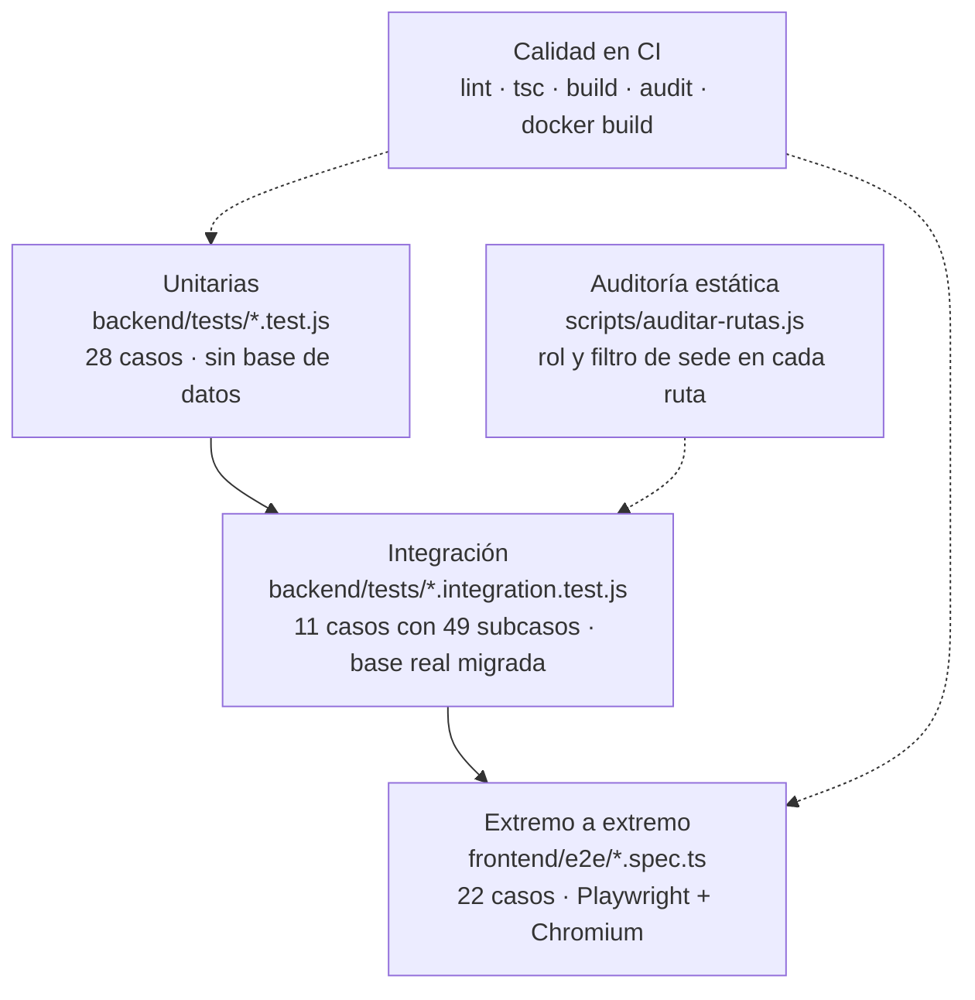

# Plan e informe de pruebas — RemiSoft

> Cubre los criterios **7 (plan de pruebas)**, **8 (informe de pruebas unitarias, mínimo 20 casos)**
> y sirve de base al **9 (reporte de ejecución y defectos)**, que se entrega aparte en
> `04-reporte-ejecucion-pruebas.md`.
>
> Todo lo que aparece aquí se contó leyendo el repositorio en la rama `develop`, no de memoria:
> los archivos de `backend/tests/`, los de `frontend/e2e/` y el workflow `.github/workflows/ci.yml`.

---

## 1. Alcance

### 1.1 Qué se prueba

| Módulo | Qué se verifica | Nivel |
|---|---|---|
| Identidad y sesión | Login, JWT, rol en cada ruta, recuperación de contraseña | Unitaria + integración + E2E |
| Aislamiento multisede | Que un usuario de una sede no lea ni escriba datos de otra | Unitaria + integración |
| Salón | Comandas, rondas, cancelación, precuenta | Unitaria + integración + E2E |
| Cocina | Avance de ítems, transiciones y conflicto por estado desactualizado | Integración + E2E |
| Caja y facturación | Cierre de cuenta, pagos mixtos, división de cuenta, arqueo | Unitaria + integración |
| Inventario | Descuento por receta, conciliación de stock, unidades base | Integración |
| Personal y establecimientos | Altas, edición, privacidad del correo | Unitaria + integración + E2E |
| Consistencia visual y accesibilidad | Contraste, foco, tamaños, modo oscuro, teclado | E2E |
| Auditoría de rutas | Que toda ruta montada declare rol y filtro de sede | Unitaria (estática) |

### 1.2 Qué NO se prueba (y por qué)

| Fuera de alcance | Motivo |
|---|---|
| Carga y estrés | No hay objetivo de rendimiento declarado; el sistema es de una sede por instancia |
| Pruebas de penetración | Se cubren los controles básicos (helmet, rate-limit, roles) sin auditoría formal |
| Integración real con la DIAN | La facturación electrónica es deuda técnica declarada, no está implementada |
| Navegadores distintos de Chromium | Playwright corre solo Chromium por costo de tiempo en CI |
| Recuperación ante desastre | Depende de la infraestructura del cliente, no del código |

---

## 2. Niveles de prueba



- **Unitarias:** prueban funciones puras y módulos sin tocar MariaDB (validaciones, cálculo de
  factura, resolución de sedes, reglas de comanda). Corren con `node --test` en segundos.
- **Integración:** levantan la app de Express con `supertest`-style sobre `app.js` y una base
  **migrada y aislada**. Crean su propia sede y sus propios registros con identificadores
  aleatorios, así que no necesitan `datos.sql` y no tocan datos reales.
- **Extremo a extremo:** Playwright maneja el navegador contra frontend + backend + base; recorre
  flujos completos (mesa libre hasta comprobante del cajero).
- **Auditoría estática:** `scripts/auditar-rutas.js` recorre `src/routes/` y falla si una ruta no
  declara rol o no aplica el filtro de sede. Es la prueba que impide que el aislamiento multisede
  se rompa por descuido en una ruta nueva.

---

## 3. Ambientes

| Ambiente | Composición | Uso |
|---|---|---|
| Local de desarrollo | `docker compose up -d db backend frontend` + `pnpm test` | Unitarias siempre; integración con base `_test` |
| Base de pruebas | MariaDB 11.4.4 con nombre terminado en `_test`, migrada con `prisma migrate deploy` | Obligatoria para integración; los tests **abortan si el nombre no termina en `_test`** |
| CI (GitHub Actions) | `ubuntu-latest`, Node 20.19.4, pnpm 10.15.0 | Lint, unitarias, build, audit y build de imágenes |
| E2E local | Frontend y backend levantados + Playwright | Flujos completos |

### 3.1 Guardas de seguridad de las pruebas

1. Los archivos de integración declaran `{ skip: process.env.ESTABLECIMIENTO_DB_TEST !== '1' }`
   (o `SALON_DB_TEST` en el flujo de salón). Sin la variable, **se saltan** en vez de fallar.
2. Cada archivo valida que `DB_DATABASE` termine en `_test` con
   `assert.match(process.env.DB_DATABASE, /_test$/, 'Usa una base aislada con sufijo _test')`.
   Es imposible apuntar por error a la base de producción.
3. Los datos se crean con `randomUUID()` y números de mesa aleatorios: dos ejecuciones seguidas no
   chocan entre sí.

### 3.2 Cómo se ejecuta cada nivel

```powershell
# Unitarias (no necesitan base de datos)
cd backend
pnpm test

# Un solo archivo
node --test tests/facturacion.test.js

# Integración (base aislada terminada en _test, ya migrada)
$env:ESTABLECIMIENTO_DB_TEST = '1'
$env:DB_DATABASE = 'remisoft_test'
pnpm test

# Flujo de salón, que usa su propia bandera
$env:SALON_DB_TEST = '1'
node --test tests/salon.integration.test.js

# Extremo a extremo
cd frontend
pnpm exec playwright test
```

---

## 4. Inventario de casos automatizados

### 4.1 Backend — 7 archivos unitarios, 28 casos

| Archivo | Casos | Qué cubre |
|---|---|---|
| `multisede.test.js` | 8 | `sedesPermitidas` y `puedeEntrarSede`: superadmin sin límite, gerente de una sede, gerente multisede, sede activa, ids inválidos, usuario sin sede, filtro por sede activa y 403 en vez de consulta global |
| `validation.test.js` | 6 | Correo obligatorio, longitud máxima, normalización de espacios, clave única de correo, cantidades positivas y conteo absoluto en cero |
| `facturacion.test.js` | 4 | Centavos, descuento antes del IVA, propina no gravada, importes negativos o fuera de rango, renglones del propio pedido y bloqueo de pago en efectivo repetido |
| `aislamiento-rutas.test.js` | 4 | Auditoría de rutas: toda ruta montada declara rol y filtro de sede, el CLI sale con código 0, detecta rutas huérfanas y la sede no la elige el cliente |
| `salon.test.js` | 3 | Comanda con platos, cantidades enteras y renglones distintos; entrega solo con el último plato servido; la precuenta no factura renglones cancelados |
| `establecimiento.test.js` | 2 | La ausencia de sede no convierte a nadie en lector global; el filtro de mesero no quita la sede a los demás |
| `health.test.js` | 1 | `GET /health` responde con el estado del backend |
| **Total** | **28** | |

### 4.2 Backend — 10 archivos de integración, 11 casos con 49 subcasos

| Archivo | Casos | Subcasos | Qué cubre |
|---|---|---|---|
| `aislamiento-sedes.integration.test.js` | 2 | 14 | Gerente B no ve ni modifica la sede A; cambio de sede sin perder el aislamiento |
| `panel-gerente.integration.test.js` | 1 | 6 | Movimientos, saldos y permisos de dos establecimientos |
| `conteo-inventario.integration.test.js` | 1 | 5 | Crear y editar ingredientes concilia el stock con el historial |
| `establecimiento.integration.test.js` | 1 | 5 | Cada establecimiento nace vacío y conserva su propio catálogo |
| `unidades-inventario.integration.test.js` | 1 | 5 | Unidad base del ingrediente y cantidades históricas |
| `salon.integration.test.js` | 1 | 4 | Salón → cocina → entrega → caja → factura con concurrencia e inventario reales |
| `cierre-total.integration.test.js` | 1 | 4 | Cierre total por sede, cajas e historial |
| `correo.integration.test.js` | 1 | 3 | Privacidad del correo en altas, ediciones y solicitudes |
| `jornada.integration.test.js` | 1 | 3 | Jornada completa de un negocio nuevo: gerencia → salón → cocina → caja → arqueo |
| `cocina-caja.integration.test.js` | 1 | 0 | Mesero → cocinero → caja con aislamiento por sede, pagos mixtos y recibos |
| **Total** | **11** | **49** | |

### 4.3 Frontend — 4 specs, 22 casos definidos

| Archivo | Casos | Qué cubre |
|---|---|---|
| `consistencia-visual.spec.ts` | 17 | Contraste en modo oscuro, tipografía, formularios en móvil, paginación, impresión del comprobante, ayudas por teclado y pantalla de acceso |
| `salon.spec.ts` | 3 | Mesa libre hasta comprobante del cajero; tomar y cancelar un pedido; la tarjeta abre una sola ficha con todos los pedidos |
| `establecimiento.spec.ts` | 1 | Altas de gerente y personal, corrección de correo |
| `jornada.spec.ts` | 1 | Primera venta vista desde los paneles de gerente, mesero y cajero |
| **Total** | **22** | |

Varios casos de `consistencia-visual.spec.ts` están parametrizados por ancho de pantalla, así que
en ejecución se multiplican: el número de pasos reales es mayor que el de casos declarados.

### 4.4 Totales

| Nivel | Archivos | Casos | Subcasos |
|---|---|---|---|
| Unitarias backend | 7 | 28 | — |
| Integración backend | 10 | 11 | 49 |
| E2E Playwright | 4 | 22 | — |
| **Total** | **21** | **61** | **49** |

El criterio académico pide **mínimo 20 casos automatizados**: se cumplen con **61 casos de nivel
superior** y 49 subcasos, repartidos en 21 archivos.

---

## 5. Matriz de trazabilidad pruebas ↔ requisitos

| Caso o grupo | Historia de usuario | Requisito |
|---|---|---|
| `multisede.test.js`, `aislamiento-sedes.integration.test.js` | HU-002, HU-006 | RF-01, RNF-02 |
| `validation.test.js`, `correo.integration.test.js` | HU-004, HU-010 | RF-02 |
| `facturacion.test.js`, `cierre-total.integration.test.js` | HU-013, HU-014 | RF-05 |
| `salon.test.js`, `salon.integration.test.js`, `salon.spec.ts` | HU-007, HU-008 | RF-03 |
| `cocina-caja.integration.test.js` | HU-011, HU-012 | RF-04 |
| `conteo-inventario`, `unidades-inventario` | HU-016, HU-017 | RF-06 |
| `panel-gerente.integration.test.js` | HU-020 | RF-07 |
| `jornada.integration.test.js`, `jornada.spec.ts` | HU-001 a HU-030 (transversal) | Todos |
| `establecimiento.*`, `establecimiento.spec.ts` | HU-003, HU-005 | RF-01 |
| `consistencia-visual.spec.ts` | HU-024, HU-025 | RNF-01, RNF-03 |
| `health.test.js` | — | RNF-04 (disponibilidad) |

---

## 6. Criterios de entrada y salida

### 6.1 Entrada (para poder ejecutar)

- Base de datos migrada y accesible, con nombre terminado en `_test`.
- Variables de entorno cargadas (`.env` o las del compose): `DATABASE_URL`, `JWT_SECRET`, SMTP.
- Dependencias instaladas con `pnpm install --frozen-lockfile`.
- Frontend compilado para E2E (`pnpm build`) y backend escuchando.

### 6.2 Salida (para dar por buena una corrida)

- **0 fallos** en unitarias y en la auditoría de rutas.
- **0 fallos** en integración, y **ningún caso saltado por la bandera** cuando se ejecuta en el
  ambiente de pruebas (si se salta, no cuenta como aprobado).
- Lint de backend y frontend sin errores; `tsc` y `vite build` sin errores.
- Cobertura funcional de los flujos críticos: login, tomar pedido, cocina, cobro, inventario.

---

## 7. Lo que el CI hace hoy y lo que le falta

El workflow `.github/workflows/ci.yml` corre en cada push y PR a `develop` y `main`, con un solo
job (`quality`), en este orden:

1. Instala dependencias de backend y frontend con `pnpm --frozen-lockfile`.
2. `pnpm audit --audit-level=high` en ambos (con `continue-on-error`, así que informa pero no bloquea).
3. `prisma generate`.
4. `lint` del backend.
5. `pnpm run test` del backend.
6. `lint` y `build` del frontend.
7. `docker compose config` y `docker compose build`.

**Hallazgo honesto:** el paso de pruebas **no tiene servicio de base de datos**. Como los archivos
de integración se saltan cuando falta la bandera, en CI se ejecutan solo las **28 unitarias** y los
**60 casos de integración/subcasos quedan saltados**. Eso no invalida el trabajo —las integraciones
sí se corren en local con la base `_test`—, pero es la brecha que hay que cerrar para que el CI
pruebe de verdad. La corrección concreta es agregar un servicio de MariaDB al job y exportar la
bandera. Se documenta como acción pendiente, no se da por hecho.

---

## 8. Riesgos de la estrategia de pruebas

| Riesgo | Impacto | Mitigación |
|---|---|---|
| Integración saltada en CI | Un fallo de base puede llegar a `develop` | Agregar `services: mariadb` y `ESTABLECIMIENTO_DB_TEST=1` al workflow |
| Dependencia de datos demo | Si `datos.sql` cambia, algunos flujos E2E se rompen | Los tests de integración crean sus propios datos; los E2E usan el usuario demo |
| Solo Chromium en E2E | Un fallo de Safari o Firefox no se ve | Se acepta por costo; la consistencia visual se cubre por anchos de pantalla |
| Sin mocks de SMTP | El correo real se envía en pruebas locales | Mailtrap como buzón de pruebas; nunca SMTP de producción |
| Pruebas sin medición de cobertura | No se sabe qué porcentaje del código está probado | Pendiente: `--experimental-test-coverage` de Node 20 |

---

## 9. Resumen para la sustentación

- **21 archivos** de prueba: 7 unitarios, 10 de integración, 4 de extremo a extremo.
- **61 casos** de nivel superior y **49 subcasos**, muy por encima del mínimo de 20.
- El aislamiento multisede —el requisito más delicado del sistema— tiene **pruebas propias en los
  tres niveles**: unitaria, integración y una auditoría estática que impide introducir una ruta sin
  filtro de sede.
- La brecha declarada es el CI sin base de datos: **28 casos corren siempre, 60 esperan la bandera**.
