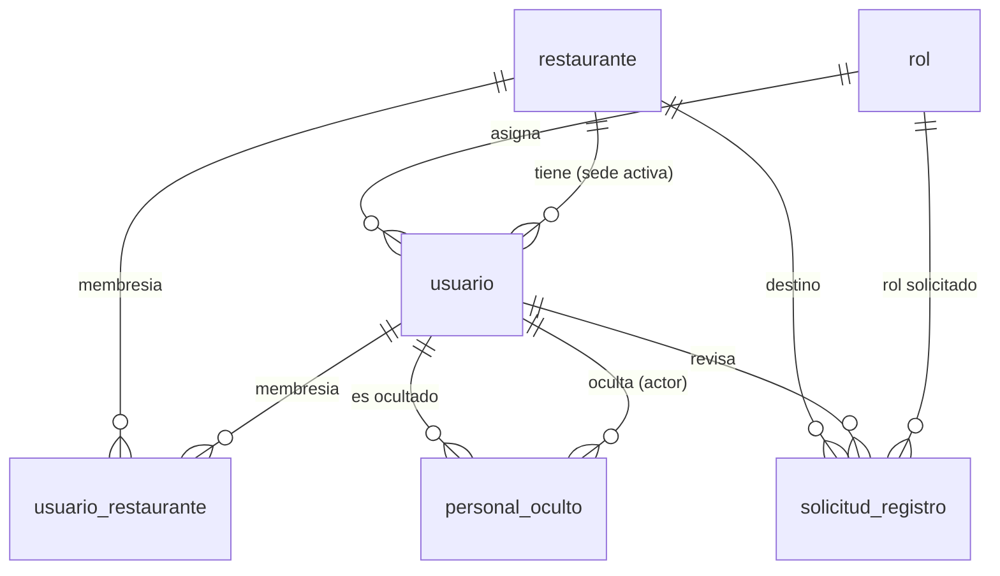
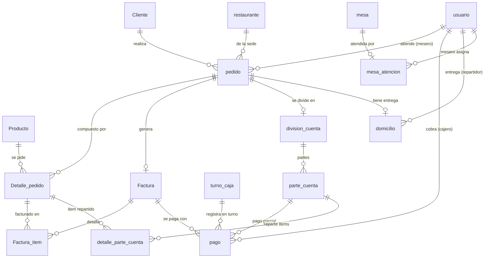
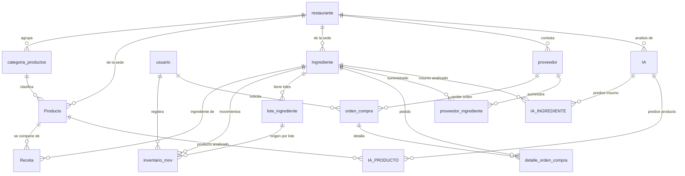
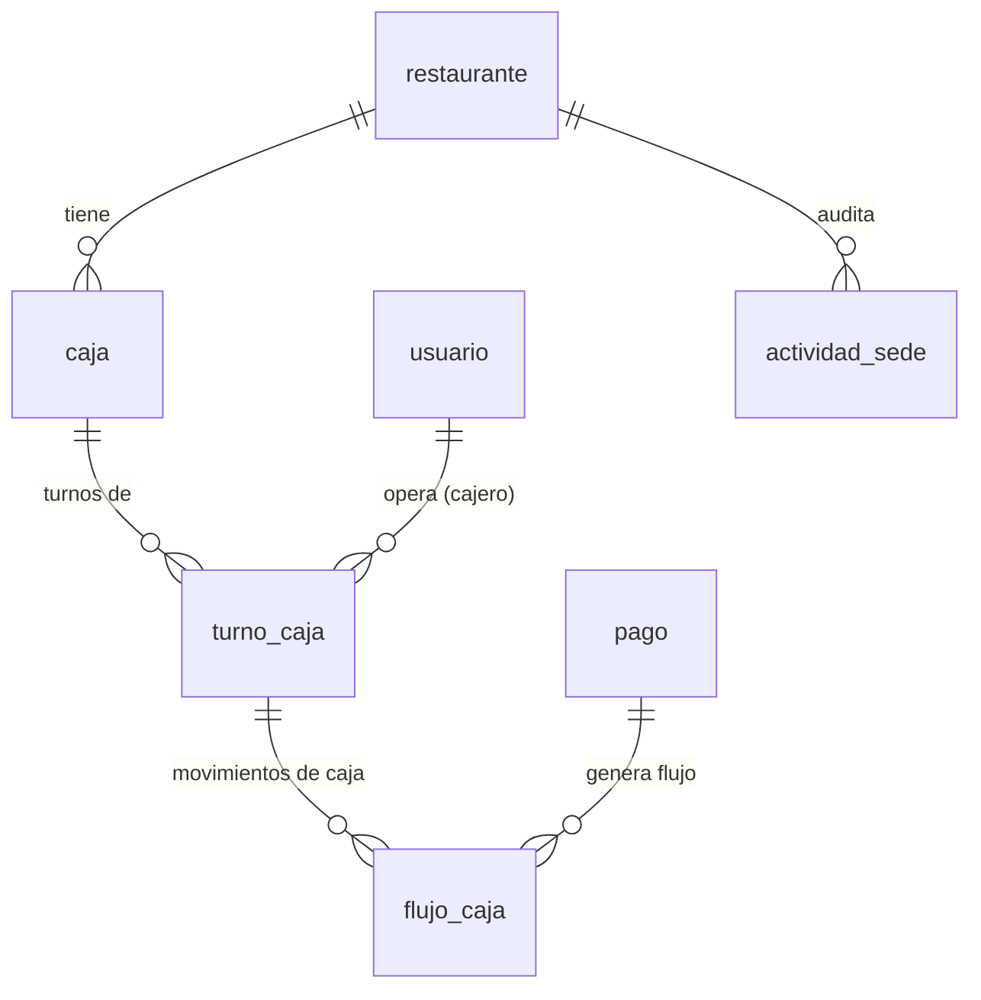

# Modelo de datos — RemiSoft

Fuente de verdad: [`backend/prisma/schema.prisma`](../backend/prisma/schema.prisma) (Prisma + MariaDB).
Este documento presenta el **Modelo Entidad-Relación (MER)** conceptual y el **Modelo Relacional (MR)**
físico resultante. Generado como parte de la documentación general del proyecto (checklist, criterio 1).

**Convenciones**

| Símbolo | Significado |
|---------|-------------|
| PK | Llave primaria |
| FK | Llave foránea (`→ tabla`) |
| UQ | Restricción única |
| NN | No nulo |
| AI | Autoincremental |

> **Patrón multi-sede:** la mayoría de entidades de negocio llevan `id_restaurante` (FK a `restaurante`,
> que representa una sede/establecimiento). Todas las consultas de negocio filtran por esta columna
> (aislamiento por sede). Ver [aislamiento-sedes.md](aislamiento-sedes.md).

---

## 1. Diagrama MER (conceptual)

El MER se presenta por dominios para mantener la legibilidad. La cardinalidad usa la notación
Chen/UML: `||` uno y solo uno, `o|` cero o uno, `o{` cero o muchos, `|{` uno o muchos.

### 1.1 Identidad, sedes y seguridad

### 1.2 Pedidos, salón, facturación y domicilios

### 1.3 Inventario, compras, proveedores e IA

### 1.4 Caja, turnos y auditoría

> `actividad_sede` guarda **instantáneas** de auditoría: `id_actor` es un entero sin FK,
> a propósito, para que el registro sobreviva aunque se elimine el usuario.

---

## 2. Modelo Relacional (MR)

### 2.1 Identidad y sedes

**restaurante** (sede / establecimiento)

| Atributo | Tipo | Clave | Restricciones |
|----------|------|-------|---------------|
| id_restaurante | INT | PK | AI |
| nombre | VARCHAR(100) | | NN |
| direccion | VARCHAR(200) | | |
| telefono | VARCHAR(20) | | |
| email | VARCHAR(100) | | |
| activo | BOOLEAN | | DEF `true` |
| fecha_creacion | DATETIME | | DEF `now()` |
| sistema_abierto | BOOLEAN | | DEF `true` (bloqueo global de escritura) |
| version_sistema | INT | | DEF `0` (control de concurrencia del cierre) |

**rol**

| Atributo | Tipo | Clave | Restricciones |
|----------|------|-------|---------------|
| id_rol | INT | PK | AI |
| nombre | VARCHAR(30) | UQ | SUPERADMIN, GERENTE, CAJERO, MESERO, REPARTIDOR, COCINERO |
| descripcion | VARCHAR(200) | | |

**usuario**

| Atributo | Tipo | Clave | Restricciones |
|----------|------|-------|---------------|
| id_usuario | INT | PK | AI |
| id_rol | INT | FK → rol | NN, IDX |
| identificacion | VARCHAR(20) | | |
| nombre | VARCHAR(60) | | |
| apellido | VARCHAR(60) | | |
| email | VARCHAR(100) | UQ | IDX `email` |
| telefono | VARCHAR(20) | | |
| contrasena_hash | VARCHAR(255) | | bcrypt |
| activo | BOOLEAN | | DEF `true` |
| estado | VARCHAR(20) | | DEF `ACTIVO` |
| fecha_registro | DATETIME | | DEF `now()` |
| id_restaurante | INT | FK → restaurante | sede **activa** de la sesión |

**usuario_restaurante** (membresías multisede)

| Atributo | Tipo | Clave | Restricciones |
|----------|------|-------|---------------|
| id_usuario | INT | PK, FK → usuario | ON DELETE CASCADE |
| id_restaurante | INT | PK, FK → restaurante | ON DELETE CASCADE |
| fecha_asignacion | DATETIME | | DEF `now()` |

**personal_oculto** (bajas de personal sin borrar filas)

| Atributo | Tipo | Clave | Restricciones |
|----------|------|-------|---------------|
| id_actor | INT | PK, FK → usuario | quien oculta, CASCADE |
| id_usuario | INT | PK, FK → usuario | ocultado, CASCADE |

**solicitud_registro**

| Atributo | Tipo | Clave | Restricciones |
|----------|------|-------|---------------|
| id_solicitud | INT | PK | AI |
| nombre / apellido | VARCHAR(60) | | NN |
| email | VARCHAR(100) | UQ | |
| telefono | VARCHAR(20) | | |
| contrasena_hash | VARCHAR(255) | | NN |
| id_rol_solicitado | INT | FK → rol | IDX |
| nombre_establecimiento | VARCHAR(100) | | si crea sede nueva |
| id_restaurante | INT | FK → restaurante | IDX |
| estado | VARCHAR(20) | | DEF `PENDIENTE` (APROBADA/RECHAZADA) |
| motivo_rechazo | VARCHAR(500) | | |
| fecha_solicitud / fecha_revision | DATETIME | | |
| revisado_por | INT | FK → usuario | IDX |

### 2.2 Catálogo de productos e ingredientes

**categoria_productos**

| Atributo | Tipo | Clave | Restricciones |
|----------|------|-------|---------------|
| id_categoria | INT | PK | AI |
| id_restaurante | INT | FK → restaurante | |
| nombre | VARCHAR(100) | | NN, UQ (`id_restaurante`, `nombre`) |
| descripcion | VARCHAR(255) | | |

**Producto**

| Atributo | Tipo | Clave | Restricciones |
|----------|------|-------|---------------|
| id_producto | INT | PK | AI |
| id_restaurante | INT | FK → restaurante | IDX |
| Nombre | VARCHAR(50) | | |
| Descripcion | VARCHAR(500) | | |
| precio_venta | DECIMAL(10,2) | | |
| Categoria | VARCHAR(30) | | legado (texto); el FK real es `id_categoria` |
| Tiempo_preparacion | TIME | | |
| Estado | INT | | DEF `1` (disponible) |
| id_categoria | INT | FK → categoria_productos | IDX |

**Ingrediente**

| Atributo | Tipo | Clave | Restricciones |
|----------|------|-------|---------------|
| id_ingrediente | INT | PK | AI |
| id_restaurante | INT | FK → restaurante | IDX |
| nombre | VARCHAR(50) | | |
| descripcion | VARCHAR(500) | | |
| unidad_medida | VARCHAR(20) | | unidad **base** del libro de movimientos |
| unidad_presentacion | VARCHAR(20) | | unidad de compra/empaque |
| cantidad_base | DECIMAL(16,6) | | DEF `1` (equivalencia presentación → base) |
| factor_unidad | DECIMAL(16,6) | | DEF `1` |
| costo_unitario_ref | DECIMAL(10,2) | | |
| stock_minimo | DECIMAL(10,2) | | DEF `0` |

**Receta** (N:M Producto ↔ Ingrediente con cantidad)

| Atributo | Tipo | Clave | Restricciones |
|----------|------|-------|---------------|
| id_receta | INT | PK | AI |
| id_producto | INT | FK → Producto | IDX |
| id_ingrediente | INT | FK → Ingrediente | IDX |
| Cantidad_necesaria | DECIMAL(10,3) | | |
| Unidad | VARCHAR(20) | | |

### 2.3 Pedidos, facturación y domicilios

**pedido**

| Atributo | Tipo | Clave | Restricciones |
|----------|------|-------|---------------|
| id_pedido | INT | PK | AI |
| id_restaurante | INT | FK → restaurante | IDX |
| id_cliente | INT | FK → Cliente | IDX, opcional |
| id_mesero | INT | FK → usuario | IDX, opcional |
| Fecha_hora | DATETIME | | DEF `now()` |
| estado | VARCHAR(20) | | DEF `ABIERTO` |
| Tipo_pedido | VARCHAR(20) | | MESA / DOMICILIO / LLEVAR |
| Mesa_num | INT | | número de mesa (salón) |
| notas | VARCHAR(500) | | |
| comensales | INT | | |
| version_salon | INT | | control de concurrencia del salón |

**Detalle_pedido**

| Atributo | Tipo | Clave | Restricciones |
|----------|------|-------|---------------|
| id_detalle | INT | PK | AI |
| id_pedido | INT | FK → pedido | NN, IDX |
| id_producto | INT | FK → Producto | NN, IDX |
| Cantidad | INT | | |
| Precio_unitario | DECIMAL(10,2) | | |
| nota | VARCHAR(200) | | |
| estado_item | VARCHAR(20) | | DEF `PENDIENTE` (ciclo de cocina) |

**Cliente**

| Atributo | Tipo | Clave | Restricciones |
|----------|------|-------|---------------|
| id_cliente | INT | PK | AI |
| id_restaurante | INT | FK → restaurante | UQ con Email |
| Nombre / Apellido | VARCHAR(50) | | Nombre NN en la API |
| Email | VARCHAR(60) | | UQ (`id_restaurante`, `Email`) |
| Telefono | VARCHAR(20) | | |
| Direccion | VARCHAR(120) | | |
| coordenadas_gps | VARCHAR(80) | | |
| tipo_documento / Num_documento | VARCHAR(30) | | |
| fecha_registro | DATETIME | | DEF `now()` |

**Factura**

| Atributo | Tipo | Clave | Restricciones |
|----------|------|-------|---------------|
| id_factura | INT | PK | AI |
| id_pedido | INT | FK → pedido | NN, UQ (1 factura por pedido) |
| Fecha_emision | DATETIME | | DEF `now()` |
| consecutivo | VARCHAR(40) | | |
| CUFE | VARCHAR(80) | | normativa DIAN |
| receptor | VARCHAR(120) | | |
| tasa_iva | DECIMAL(7,6) | | |
| version_edicion | INT | | DEF `0`, concurrencia optimista |
| IVA / Descuento / Propina / total | DECIMAL(10,2) | | |
| estado | VARCHAR(20) | | DEF `EMITIDA` |

**Factura_item** (PK compuesta)

| Atributo | Tipo | Clave | Restricciones |
|----------|------|-------|---------------|
| id_factura | INT | PK, FK → Factura | |
| id_detalle_pedido | INT | PK, FK → Detalle_pedido | IDX |
| cantidad_facturada | INT | | |
| nombre_producto | VARCHAR(50) | | snapshot del nombre |
| precio_unitario | DECIMAL(10,2) | | |

**pago**

| Atributo | Tipo | Clave | Restricciones |
|----------|------|-------|---------------|
| id_pago | INT | PK | AI |
| id_factura | INT | FK → Factura | NN, IDX |
| id_usuario_cajero | INT | FK → usuario | NN, IDX |
| fecha_pago | DATETIME | | DEF `now()` |
| metodo | VARCHAR(30) | | EFECTIVO / TARJETA / ... |
| monto | DECIMAL(10,2) | | |
| referencia | VARCHAR(80) | | |
| estado | VARCHAR(20) | | DEF `APROBADO` |
| id_turno | INT | FK → turno_caja | IDX |
| id_parte | INT | FK → parte_cuenta | IDX, pago dividido |
| monto_recibido / cambio | DECIMAL(10,2) | | solo efectivo |

**division_cuenta** / **parte_cuenta** / **detalle_parte_cuenta**

| Relación | Atributo | Tipo | Clave | Restricciones |
|----------|----------|------|-------|---------------|
| division_cuenta | id_division | INT | PK | AI |
| division_cuenta | id_pedido | INT | FK → pedido | UQ |
| division_cuenta | modo | VARCHAR(20) | | |
| parte_cuenta | id_parte | INT | PK | AI |
| parte_cuenta | id_division | INT | FK → division_cuenta | IDX |
| parte_cuenta | numero | INT | | UQ (`id_division`, `numero`) |
| parte_cuenta | total | DECIMAL(10,2) | | |
| detalle_parte_cuenta | id_parte | INT | PK, FK → parte_cuenta | |
| detalle_parte_cuenta | id_detalle | INT | PK, FK → Detalle_pedido | IDX |
| detalle_parte_cuenta | cantidad | INT | | |

**domicilio**

| Atributo | Tipo | Clave | Restricciones |
|----------|------|-------|---------------|
| id_domicilio | INT | PK | AI |
| id_pedido | INT | FK → pedido | NN, UQ |
| direccion | VARCHAR(150) | | |
| coordenadas_gps | VARCHAR(80) | | |
| estado | VARCHAR(20) | | DEF `ASIGNADO` |
| Fecha_asignacion / fecha_entrega | DATETIME | | |
| id_repartidor | INT | FK → usuario | IDX |

**mesa** / **mesa_atencion**

| Relación | Atributo | Tipo | Clave | Restricciones |
|----------|----------|------|-------|---------------|
| mesa | id_mesa | INT | PK | AI |
| mesa | id_restaurante | INT | FK → restaurante | IDX |
| mesa | numero | INT | | NN, UQ (`numero`, `id_restaurante`) |
| mesa | capacidad | INT | | DEF `4` |
| mesa_atencion | id_atencion | INT | PK | AI |
| mesa_atencion | numero + id_restaurante | INT | FK → mesa (compuesta) | UQ (una atención viva por mesa) |
| mesa_atencion | id_mesero | INT | FK → usuario | IDX |
| mesa_atencion | comensales | INT | | |
| mesa_atencion | desde | DATETIME | | DEF `now()` |

### 2.4 Caja y turnos

**caja**

| Atributo | Tipo | Clave | Restricciones |
|----------|------|-------|---------------|
| id_caja | INT | PK | AI |
| id_restaurante | INT | FK → restaurante | IDX |
| nombre | VARCHAR(40) | | |
| estado | VARCHAR(20) | | DEF `ACTIVA` |
| fecha_registro | DATETIME | | DEF `now()` |

**turno_caja**

| Atributo | Tipo | Clave | Restricciones |
|----------|------|-------|---------------|
| id_turno | INT | PK | AI |
| id_restaurante | INT | FK → restaurante | IDX |
| id_caja | INT | FK → caja | NN, IDX |
| id_usuario_cajero | INT | FK → usuario | NN, IDX |
| fecha_apertura / fecha_cierre | DATETIME | | |
| efectivo_inicial / efectivo_esperado / efectivo_real / diferencia | DECIMAL(10,2) | | arqueo de cierre |
| notas | VARCHAR(500) | | |
| estado | VARCHAR(20) | | DEF `ABIERTA` |

**flujo_caja**

| Atributo | Tipo | Clave | Restricciones |
|----------|------|-------|---------------|
| id_flujo | INT | PK | AI |
| id_turno | INT | FK → turno_caja | NN, IDX |
| fecha | DATETIME | | DEF `now()` |
| concepto | VARCHAR(100) | | |
| ingresos / egresos | DECIMAL(10,2) | | DEF `0` |
| saldo | DECIMAL(10,2) | | |
| metodo / referencia | VARCHAR | | |
| id_pago | INT | FK → pago | IDX |

### 2.5 Inventario, compras y proveedores

**inventario_mov** (libro de movimientos)

| Atributo | Tipo | Clave | Restricciones |
|----------|------|-------|---------------|
| id_movimiento | INT | PK | AI |
| id_restaurante | INT | FK → restaurante | IDX |
| id_ingrediente | INT | FK → Ingrediente | NN, IDX |
| id_usuario | INT | FK → usuario | IDX |
| fecha_hora | DATETIME | | DEF `now()` |
| tipo_movimiento | VARCHAR(20) | | ENTRADA / SALIDA / MERMA / AJUSTE ... |
| cantidad | DECIMAL(10,3) | | |
| costo_unitario | DECIMAL(10,2) | | |
| observaciones | VARCHAR(1000) | | |
| origen_tipo / origen_id | VARCHAR(30) / INT | | IDX (`origen_tipo`, `origen_id`): consumo por pedido |
| id_lote | INT | FK → lote_ingrediente | IDX |

**lote_ingrediente**

| Atributo | Tipo | Clave | Restricciones |
|----------|------|-------|---------------|
| id_lote | INT | PK | AI |
| id_restaurante | INT | FK → restaurante | IDX |
| id_ingrediente | INT | FK → Ingrediente | NN, IDX |
| numero_lote | VARCHAR(40) | | UQ (`id_restaurante`, `numero_lote`) |
| fecha_ingreso / fecha_vencimiento | DATE | | |
| stock_inicial / stock_actual | DECIMAL(10,3) | | |
| costo_promedio | DECIMAL(10,2) | | |
| observaciones | VARCHAR(500) | | |
| fecha_registro | DATETIME | | DEF `now()` |

**proveedor** / **proveedor_ingrediente**

| Relación | Atributo | Tipo | Clave | Restricciones |
|----------|----------|------|-------|---------------|
| proveedor | id_proveedor | INT | PK | AI |
| proveedor | id_restaurante | INT | FK → restaurante | IDX |
| proveedor | nombre / nombre_contacto | VARCHAR(100) | | |
| proveedor | telefono / email | VARCHAR | | |
| proveedor | direccion | VARCHAR(200) | | |
| proveedor | nit | VARCHAR(30) | | |
| proveedor | tipo_proveedor | VARCHAR(50) | | |
| proveedor | estado | VARCHAR(20) | | DEF `ACTIVO` |
| proveedor | fecha_registro | DATETIME | | DEF `now()` |
| proveedor_ingrediente | id_proveedor | INT | PK, FK → proveedor | |
| proveedor_ingrediente | id_ingrediente | INT | PK, FK → Ingrediente | IDX |
| proveedor_ingrediente | precio_acordado | DECIMAL(10,2) | | |
| proveedor_ingrediente | tiempo_entrega_dias | INT | | |
| proveedor_ingrediente | calidad_rating | DECIMAL(2,1) | | |
| proveedor_ingrediente | es_proveedor_principal | BOOLEAN | | DEF `false` |
| proveedor_ingrediente | fecha_ultima_compra | DATETIME | | |

**orden_compra** / **detalle_orden_compra**

| Relación | Atributo | Tipo | Clave | Restricciones |
|----------|----------|------|-------|---------------|
| orden_compra | id_orden_compra | INT | PK | AI |
| orden_compra | id_restaurante | INT | FK → restaurante | IDX |
| orden_compra | id_proveedor | INT | FK → proveedor | NN, IDX |
| orden_compra | id_usuario | INT | FK → usuario | NN, IDX |
| orden_compra | fecha_orden | DATETIME | | DEF `now()` |
| orden_compra | fecha_entrega_esperada / fecha_entrega_real | DATE | | |
| orden_compra | estado | VARCHAR(30) | | DEF `PENDIENTE` |
| orden_compra | observaciones | VARCHAR(500) | | |
| detalle_orden_compra | id_detalle_compra | INT | PK | AI |
| detalle_orden_compra | id_orden_compra | INT | FK → orden_compra | NN, IDX |
| detalle_orden_compra | id_ingrediente | INT | FK → Ingrediente | NN, IDX |
| detalle_orden_compra | cantidad_solicitada / cantidad_recibida | DECIMAL(10,2) | | recibida DEF `0` |
| detalle_orden_compra | precio_unitario | DECIMAL(10,2) | | |

### 2.6 Analítica (IA)

**IA** / **IA_INGREDIENTE** / **IA_PRODUCTO**

| Relación | Atributo | Tipo | Clave | Restricciones |
|----------|----------|------|-------|---------------|
| IA | id_IA | INT | PK | AI |
| IA | id_restaurante | INT | FK → restaurante | IDX |
| IA | Fecha_generacion | DATETIME | | DEF `now()` |
| IA | Tipo_prediccion | VARCHAR(50) | | |
| IA | Resultado_generado / Recomendaciones_generales | VARCHAR(500) | | |
| IA | Nivel_confianza | DECIMAL(4,3) | | |
| IA | periodo_inicio / periodo_fin | DATE | | |
| IA_INGREDIENTE | id_IA_ingrediente | INT | PK | AI |
| IA_INGREDIENTE | id_IA | INT | FK → IA | NN, IDX |
| IA_INGREDIENTE | id_ingrediente | INT | FK → Ingrediente | NN, IDX |
| IA_INGREDIENTE | Demanda_predicha_ingrediente | DECIMAL(10,2) | | |
| IA_INGREDIENTE | Nivel_confianza | DECIMAL(4,3) | | |
| IA_INGREDIENTE | Ingrediente_critico | BOOLEAN | | DEF `false` |
| IA_PRODUCTO | id_IA_producto | INT | PK | AI |
| IA_PRODUCTO | id_IA | INT | FK → IA | NN, IDX |
| IA_PRODUCTO | id_producto | INT | FK → Producto | NN, IDX |
| IA_PRODUCTO | demanda_predicho_producto | DECIMAL(10,2) | | |
| IA_PRODUCTO | nivel_confianza_producto | DECIMAL(4,3) | | |
| IA_PRODUCTO | Producto_critico | BOOLEAN | | DEF `false` |
| IA_PRODUCTO | Recomendacion_producto | VARCHAR(200) | | |

### 2.7 Auditoría

**actividad_sede** (instantáneas; sin FK a propósito)

| Atributo | Tipo | Clave | Restricciones |
|----------|------|-------|---------------|
| id_evento | INT | PK | AI |
| id_restaurante | INT | | NN |
| fecha | DATETIME(3) | | DEF `now()` |
| id_actor | INT | | sin FK (snapshot) |
| actor | VARCHAR(150) | | nombre congelado |
| entidad / registro / accion | VARCHAR / INT / VARCHAR(40) | | qué se tocó |
| campos / antes / despues | VARCHAR(500) | | diff legible |
| grupo | VARCHAR(20) | | DEF `OTROS` |
| movimiento | JSON | | detalle estructurado |
| id_ingrediente_mov | INT | | índice por insumo |

Índices: (`id_restaurante`, `grupo`, `id_evento`), (`id_restaurante`, `id_ingrediente_mov`, `id_evento`),
(`id_restaurante`, `id_evento`).

**contexto_actividad** (vive solo dentro de la transacción de escritura)

| Atributo | Tipo | Clave |
|----------|------|-------|
| conexion | BIGINT UNSIGNED | PK |
| area | VARCHAR(20) | |
| id_actor | INT | |
| actor | VARCHAR(150) | |

---

## 3. Tablas de infraestructura (fuera del MER)

Heredadas del legado Laravel (`database/legacy/`) y del sistema de colas/sesiones. **No participan
en las reglas de negocio** y no se incluyen en el MER:

`cache`, `cache_locks`, `failed_jobs`, `job_batches`, `jobs`, `migrations`, `sessions`, `users`,
`password_reset_tokens`, `personal_access_tokens`.

---

## 4. Reglas de integridad destacadas

1. **Aislamiento por sede:** toda fila de negocio lleva `id_restaurante` y las consultas lo filtran
   (`filtroRestaurante` en `backend/src/utils/restaurante.js`). Únicos compuestos con sede:
   `(id_restaurante, Email)` en Cliente, `(id_restaurante, nombre)` en categorías,
   `(id_restaurante, numero_lote)` en lotes, `(numero, id_restaurante)` en mesas.
2. **Una factura por pedido** (`Factura.id_pedido` UQ) y **un domicilio por pedido**
   (`domicilio.id_pedido` UQ).
3. **Concurrencia optimista:** `Factura.version_edicion`, `pedido.version_salon` y
   `restaurante.version_sistema` evitan escrituras perdidas (errores `P2034` → 409).
4. **Nada se borra en auditoría:** `personal_oculto` oculta usuarios y `actividad_sede` congela
   snapshots con `id_actor` sin FK.
5. **Stock derivado:** el stock actual se calcula del libro `inventario_mov` (+ lotes); los ajustes
   manuales y consumos por pedido (`origen_tipo`/`origen_id`) se registran como movimientos.
