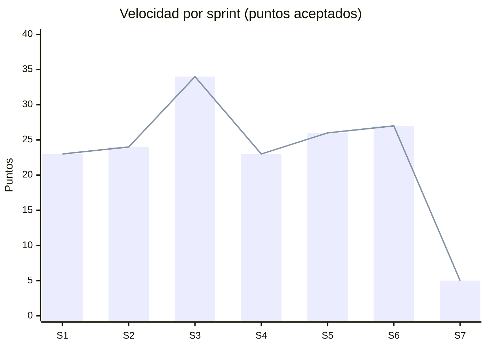
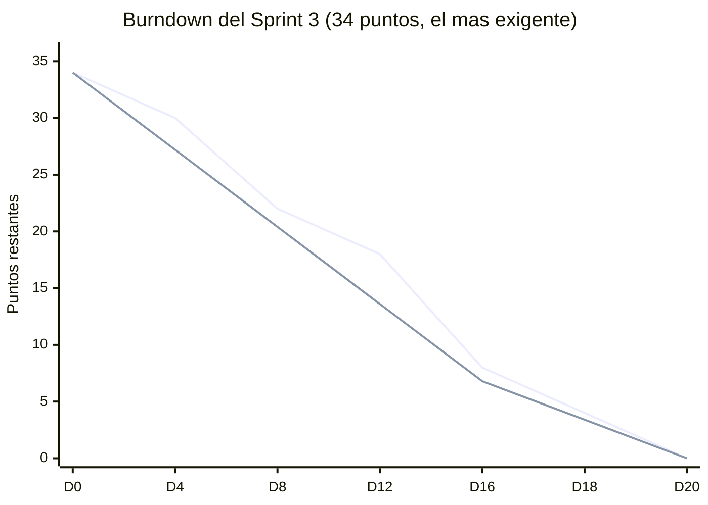

# Informe Scrum — RemiSoft

**Periodo:** 12 de marzo – 25 de noviembre de 2026 · **Sprints cerrados:** 7 (+ S0 de definición)
**Puntos del backlog:** 175 en 30 HUs + 21 en spikes de soporte → **196 puntos totales**
**Puntos aceptados:** **162** (26 de 30 HUs + 3 spikes) · **Deuda declarada:** 34 puntos

> Las cifras se reconstruyeron con las fechas reales de fusión de los 233 PR y el estado verificado de cada
> historia en el repositorio (rutas montadas, controladores y pruebas).

## 1. Velocidad

| Sprint | Fechas | Comprometido | Aceptado | % cumplido |
|---|---|---|---|---|
| S1 | 1 – 28 jun | 23 | 23 | 100 % |
| S2 | 29 jun – 26 jul | 24 | 24 | 100 % |
| S3 | 27 jul – 23 ago | 34 | 34 | 100 % |
| S4 | 24 ago – 20 sep | 23 | 23 | 100 % |
| S5 | 21 sep – 18 oct | 26 | 26 | 100 % |
| S6 | 19 oct – 15 nov | 27 | 27 | 100 % |
| S7 | 16 – 25 nov | 13 | 5 | 38 % |
| **Total** | | **170** | **162** | **95 %** |

**Velocidad promedio (S1-S6, sprints completos de 4 semanas): 26,2 puntos.**
**Velocidad del sprint corto de cierre (10 días): 5 puntos** (equivalente a ~10 puntos en 4 semanas).

**Lectura:** del S1 al S6 la velocidad fue estable en 23-27 puntos, con un pico en S3 por el spike de caja y
turnos. La caída del S7 no es una caída de capacidad: es un sprint de 10 días cuyo alcance dependía de la IA.

## 2. Burndown

Puntos restantes al cierre de cada día (D0 = inicio del sprint, D20 = último día; el S7 duró D0-D10).
La columna *Ideal* es la línea recta desde lo comprometido hasta cero.

| Sprint | Ideal D20→0 | D0 | D2 | D4 | D6 | D8 | D10 | D12 | D14 | D16 | D18 | D20 |
|---|---|---|---|---|---|---|---|---|---|---|---|---|
| S1 (23) | 23 → 0 | 23 | 23 | 20 | 18 | 15 | 15 | 12 | 8 | 8 | 3 | **0** |
| S2 (24) | 24 → 0 | 24 | 24 | 19 | 19 | 16 | 11 | 11 | 8 | 5 | 3 | **0** |
| S3 (34) | 34 → 0 | 34 | 34 | 30 | 26 | 22 | 18 | 18 | 12 | 8 | 4 | **0** |
| S4 (23) | 23 → 0 | 23 | 23 | 18 | 18 | 13 | 13 | 10 | 8 | 5 | 2 | **0** |
| S5 (26) | 26 → 0 | 26 | 26 | 23 | 21 | 21 | 16 | 13 | 13 | 8 | 3 | **0** |
| S6 (27) | 27 → 0 | 27 | 27 | 24 | 22 | 19 | 19 | 14 | 14 | 9 | 4 | **0** |
| S7 (13) | 13 → 0 | 13 | 13 | 13 | 13 | 11 | 10 | 8 | 8 | 8 | 8 | **8** |

**Patrón observado:** en todos los sprints el primer tercio avanza por debajo de la línea ideal
(la primera semana se va en diseño y en montar el entorno) y el equipo recupera en el último tercio.
El S7 se estanca a partir de D6 porque la historia de IA no avanzó.

## 3. Distribución del trabajo por persona y por tema

| Integrante | Aporte principal | Evidencia en el repositorio |
|---|---|---|
| César David Rueda Daza | Esquema, endpoints, seguridad, multi-sede | 493 commits en `develop`; `middleware/`, `controllers/`, migraciones |
| Juan Felipe Bello Pérez | Frontend, módulo de IA, landing | 86 commits; rama `feat/ia-modulo`; pantallas y componentes comunes |
| Kevin Duvan Bueno Melo | Pruebas, validaciones, QA | 69 commits; rama `feat/testing`; 13 archivos de prueba y 4 specs de Playwright |

Temas entregados por RF:

| RF | Módulo | HUs | Puntos | Estado |
|---|---|---|---|---|
| RF-001 | Gestión de usuarios | 5 | 23 | ✅ completo |
| RF-002 | Pedidos de salón | 5 | 32 | ✅ completo |
| RF-003 | Facturación | 4 | 31 | 🟡 26 aceptados, HU-014 (CUFE) como deuda |
| RF-004 | Inventario | 4 | 23 | ✅ completo |
| RF-005 | Domicilios | 4 | 23 | ✅ completo |
| RF-006 | Menú | 4 | 14 | ✅ completo |
| RF-007 | Reportes e IA | 4 | 29 | 🟡 8 aceptados; 21 en deuda |

## 4. Defectos encontrados y atendidos

| Issue / defecto | Encontrado en | Severidad | Estado |
|---|---|---|---|
| Drift de esquema: `id_restaurante` faltante en 7 tablas (#248) | S6, al probar roles | Crítica | Corregido con migración |
| El aviso del mesero lo enviaba a `/cocina` (403) | S7, prueba de roles | Alta | Corregido: el aviso solo informa |
| Decimales `DECIMAL(10,3)` con redondeo inválido | S4 | Media | Corregido + prueba automatizada |
| Retención de datos entre sedes en el módulo IA | S6 | Alta | Corregido: filtro por establecimiento |
| `JWT_SECRET` y `CARGAR_DEMO` con valores por defecto inseguros | Auditoría técnica | Alta (deuda) | **Pendiente** |
| Vulnerabilidades transitivas de Prisma en `pnpm audit` | CI | Media (deuda) | Documentado en `docs/auditoria-dependencias.md` |

## 5. Riesgos del proyecto

| Riesgo | Probabilidad | Impacto | Mitigación aplicada |
|---|---|---|---|
| Dependencia de la DIAN para CUFE | Alta | Alto | HU-014 fuera del sprint; se documenta como deuda |
| Alcance de IA mayor que el tiempo | Alta | Medio | Se acotó a "registrar predicciones" y se declaró deuda |
| Esquema heredado de la etapa Laravel | Media | Alto | Migraciones de Prisma + pruebas de integración |
| Pérdida de datos por `CARGAR_DEMO` | Media | Alto | Documentado; pendiente cambiar el default a 0 |
| Diferencias de entorno (Windows vs Linux) | Media | Medio | Todo se ejecuta en Docker; scripts `.sh` y `.ps1` |

## 6. Conclusiones

1. **Velocidad estable y predecible** en 26 puntos por sprint: el equipo puede comprometerse con holgura.
2. **El 86 % de las historias se entregó** (26 de 30) y el 95 % de los puntos comprometidos en los sprints
   de 4 semanas.
3. **La deuda está declarada, no escondida:** las tres historias de IA y la de DIAN están identificadas con
   puntos y motivo, que es lo que un informe Scrum debe mostrar.
4. **El proceso de ramas y PR funcionó:** 233 fusiones sin conflictos graves y `main` siempre estable.
5. **Lección principal:** el equipo subestima el primer tercio del sprint; conviene cerrar el diseño antes de
   comprometer puntos y no meter spikes en sprints con historias de producto.
