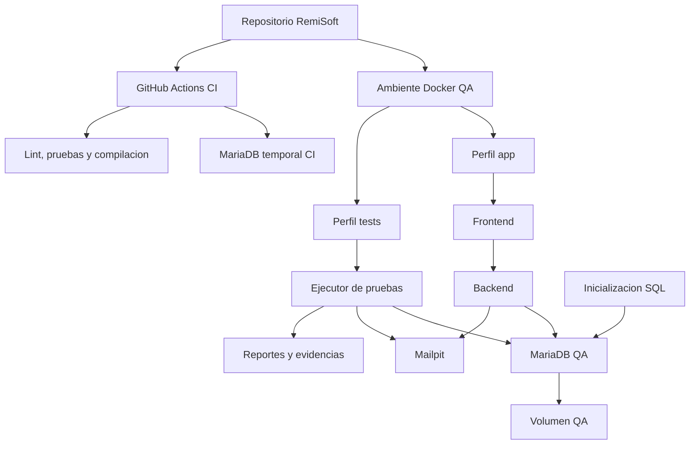

# Ambiente independiente de pruebas — RemiSoft

## 1. Introducción

El presente documento describe el ambiente independiente de pruebas (QA) del sistema RemiSoft, diseñado para realizar actividades de verificación, validación y aseguramiento de calidad sin interferir innecesariamente con el ambiente principal de desarrollo.

La configuración permite separar los recursos utilizados durante las pruebas, facilitar la reproducción de defectos y conservar evidencias de ejecución.

Este documento complementa el [Plan General de Pruebas](01-plan-general-pruebas.md).

## 2. Objetivo general

Establecer un ambiente independiente, controlado y reproducible para ejecutar las pruebas del sistema RemiSoft, protegiendo la integridad del código fuente, las configuraciones y los datos del ambiente principal.

### 2.1. Objetivos específicos

- Separar los recursos utilizados durante las pruebas.
- Proteger los datos del ambiente principal.
- Facilitar la ejecución de pruebas automatizadas.
- Utilizar credenciales exclusivas para QA.
- Generar evidencias de ejecución.
- Facilitar la reproducción y confirmación de defectos.
- Mantener la trazabilidad mediante Git y GitHub.
- Complementar los controles de integración continua.

## 3. Alcance

El ambiente QA contempla infraestructura para realizar:

- Pruebas unitarias.
- Pruebas de integración.
- Pruebas funcionales.
- Pruebas de servicios y endpoints.
- Pruebas de autenticación y autorización.
- Pruebas de aislamiento de datos.
- Pruebas de envío de correos electrónicos.
- Pruebas de regresión.
- Pruebas de confirmación de defectos.

Las pruebas adicionales de seguridad, rendimiento y servicios externos requieren procedimientos específicos.

## 4. Tecnologías utilizadas

| Tecnología | Versión o configuración | Propósito |
|---|---|---|
| Docker | Motor de contenedores | Aislamiento de servicios |
| Docker Compose | V2 | Orquestación de servicios |
| MariaDB | 11.4.4 | Base de datos |
| Node.js | 20.19.4 | Ejecución del backend |
| pnpm | 10.15.0 | Gestión de dependencias |
| Express | 4.22.2 | Servicios del backend |
| Prisma | 7.9.1 | Gestión de datos y migraciones |
| Mailpit | 1.26.2 | Captura local de correo |
| Node.js Test Runner | Integrado en Node.js | Pruebas automatizadas |
| GitHub Actions | CI | Validaciones automatizadas |
| Git | Control de versiones | Trazabilidad |
| GitHub Codespaces | Ambiente de trabajo | Preparación y validación |

Las versiones corresponden a las configuraciones y dependencias identificadas en el proyecto.

## 5. Arquitectura del ambiente de pruebas

El sistema cuenta con dos mecanismos complementarios de validación:

- Ambiente independiente de pruebas mediante Docker Compose.
- Integración continua mediante GitHub Actions.



Los ambientes QA y CI cumplen funciones complementarias y utilizan recursos diferenciados.

## 6. Separación de ambientes

| Recurso | Ambiente principal | Ambiente QA |
|---|---|---|
| Archivo Compose | docker-compose.yml | docker-compose.qa.yml |
| Proyecto Docker | Principal | remisoft-qa |
| Base de datos | remisoft | remisoft_test |
| Usuario de base de datos | remisoft | qa_user |
| Puerto externo MariaDB | 3306 | 3307 |
| Puerto externo backend | 3000 | 3100 |
| Puerto externo frontend | 80 | 8080 |
| Volumen lógico | db_data | qa_db_data |
| Red | Red principal | qa_network |
| Credenciales | Configuración principal | .env.qa |
| Datos de demostración | Según configuración | Desactivados |
| Correo | Según configuración | Mailpit |

Los puertos publicados por QA se encuentran vinculados a la dirección local 127.0.0.1.

La separación reduce el riesgo de interferencia entre ambientes. Sin embargo, deberá comprobarse durante la ejecución.

## 7. Servicios del ambiente QA

### 7.1. Base de datos

El servicio db utiliza MariaDB 11.4.4.

Características:

- Base de datos remisoft_test.
- Usuario exclusivo qa_user.
- Credenciales independientes.
- Volumen separado.
- Puerto externo 3307.
- Verificación de disponibilidad mediante healthcheck.
- Datos de demostración desactivados.

### 7.2. Inicialización de base de datos

El servicio db-init utiliza el script existente:

`backend/prisma/setup-prisma.sh`

El procedimiento contempla:

- Aplicación de migraciones.
- Generación del cliente Prisma.
- Preparación de vistas SQL.
- Preparación de procedimientos almacenados.

Los archivos SQL se montan en modo de solo lectura.

La inicialización se centraliza para evitar que el backend y el ejecutor de pruebas realicen simultáneamente el mismo procedimiento.

### 7.3. Backend

El servicio backend pertenece al perfil app.

Características:

- NODE_ENV configurado como test.
- Conexión con la base de datos QA.
- Secreto JWT independiente.
- Puerto externo 3100.
- Verificación mediante healthcheck.
- Conexión con Mailpit.

### 7.4. Frontend

El servicio frontend utiliza el proceso de construcción existente del proyecto.

Su puerto externo es 8080.

La comunicación efectiva entre el frontend y el backend deberá verificarse durante la validación operativa.

### 7.5. Ejecutor de pruebas

El servicio tests pertenece al perfil tests y utiliza Node.js Test Runner.

Antes de iniciar las pruebas, verifica que el servidor de base de datos sea db y que la base de datos seleccionada sea remisoft_test.

Habilita las variables:

- ESTABLECIMIENTO_DB_TEST=1
- SALON_DB_TEST=1

Los resultados se almacenan en archivos de texto y reportes XML con formato JUnit.

Los perfiles app y tests comparten los recursos de QA. Por este motivo, deberán utilizarse en ejecuciones controladas y separadas.

### 7.6. Correo electrónico

Mailpit permite capturar mensajes generados durante las pruebas sin utilizar el proveedor de correo del ambiente principal.

| Recurso | Dirección |
|---|---|
| SMTP interno | mailpit:1025 |
| Interfaz web local | http://127.0.0.1:8025 |

Su funcionamiento efectivo se encuentra pendiente de validación en el ambiente Docker QA.

## 8. Integración continua

El proyecto dispone de un flujo de integración continua definido en:

`.github/workflows/ci.yml`

La configuración revisada incluye:

- MariaDB 11.4.4 como servicio temporal.
- Base de datos remisoft_test.
- Usuario exclusivo de CI.
- Instalación de dependencias.
- Auditoría de dependencias.
- Aplicación de migraciones.
- Generación del cliente Prisma.
- Carga de vistas y procedimientos almacenados.
- Ejecución de ESLint.
- Ejecución de pruebas unitarias y de integración.
- Compilación del frontend.
- Validación de Docker Compose principal.
- Construcción de imágenes Docker.

El flujo se ejecuta ante eventos pull_request y push asociados a las ramas develop y main.

La infraestructura CI es independiente de los recursos locales definidos en docker-compose.qa.yml.

Una ejecución exitosa de CI no constituye por sí sola una validación operativa completa del ambiente Docker QA.

## 9. Archivos de configuración

| Archivo | Función | Versionado |
|---|---|---|
| docker-compose.qa.yml | Configuración independiente QA | Sí |
| .env.qa.example | Plantilla de variables | Sí |
| .env.qa | Credenciales privadas | No |
| .git/info/exclude | Exclusiones locales | No |
| qa-artifacts/ | Resultados originales de pruebas | No |
| .github/workflows/ci.yml | Integración continua | Sí |
| docs/testing/ | Documentación QA | Sí |

Los dos archivos de configuración independiente de QA fueron incorporados a develop mediante el Pull Request #286.

## 10. Protección de credenciales

El archivo .env.qa.example contiene una plantilla sin contraseñas privadas.

| Variable | Propósito |
|---|---|
| QA_DB_ROOT_PASSWORD | Contraseña administrativa |
| QA_DB_PASSWORD | Contraseña del usuario QA |
| QA_JWT_SECRET | Secreto de autenticación |
| QA_FRONTEND_URL | Dirección del frontend |

Las credenciales privadas deben generarse de forma independiente.

Durante la preparación se generó un secreto JWT de 64 caracteres hexadecimales.

Se utilizaron las siguientes exclusiones locales:

```gitignore
/.env.qa
/backend/.env.test
/backend/.env.qa
/qa-artifacts/
```

Estas exclusiones se encuentran en .git/info/exclude y deberán reproducirse en cada clon o espacio de trabajo.

No se modificó el archivo .gitignore original durante la implementación del ambiente QA.

## 11. Procedimiento de preparación

> Los procedimientos de ejecución requieren autorización previa y verificación de las condiciones del ambiente.

### 11.1. Obtener la configuración

La configuración está disponible en develop desde el commit de integración 5b86de5.

Se deberá utilizar una copia de trabajo actualizada, autorizada y sin cambios pendientes que puedan perderse.

### 11.2. Verificar exclusiones

```bash
git check-ignore -v .env.qa backend/.env.test backend/.env.qa qa-artifacts/
```

Si algún archivo privado no está excluido, deberá configurarse la exclusión local antes de continuar.

### 11.3. Generar credenciales

Únicamente cuando el archivo .env.qa no exista:

```bash
(
  umask 077
  set -o noclobber
  printf 'QA_DB_ROOT_PASSWORD=%s\nQA_DB_PASSWORD=%s\nQA_JWT_SECRET=%s\nQA_FRONTEND_URL=http://localhost:8080\n' \
    "$(openssl rand -hex 24)" \
    "$(openssl rand -hex 24)" \
    "$(openssl rand -hex 32)" > .env.qa
)
```

No reutilizar credenciales de desarrollo o producción.

### 11.4. Validar la configuración

```bash
docker compose -p remisoft-qa --env-file .env.qa \
  -f docker-compose.qa.yml \
  --profile app --profile tests config --quiet
```

La operación no inicia contenedores.

## 12. Procedimiento propuesto de ejecución

Antes de iniciar los servicios se deberá comprobar la disponibilidad de recursos, puertos y credenciales, así como la identificación del proyecto Docker.

### 12.1. Iniciar servicios para pruebas

```bash
docker compose -p remisoft-qa --env-file .env.qa \
  -f docker-compose.qa.yml --profile tests \
  up -d --wait db mailpit
```

### 12.2. Inicializar la base de datos

```bash
docker compose -p remisoft-qa --env-file .env.qa \
  -f docker-compose.qa.yml --profile tests \
  run --rm --no-deps db-init
```

No continuar si la inicialización presenta errores.

### 12.3. Ejecutar pruebas automatizadas

```bash
docker compose -p remisoft-qa --env-file .env.qa \
  -f docker-compose.qa.yml --profile tests \
  run --rm --no-deps tests
```

Conservar los resultados y el código de salida de la ejecución.

### 12.4. Ejecutar pruebas funcionales

En una sesión separada, después de verificar la inicialización de la base de datos y la disponibilidad de MariaDB y Mailpit:

```bash
docker compose -p remisoft-qa --env-file .env.qa \
  -f docker-compose.qa.yml --profile app \
  up -d --no-deps --wait backend
```

Posteriormente:

```bash
docker compose -p remisoft-qa --env-file .env.qa \
  -f docker-compose.qa.yml --profile app \
  up -d --no-deps frontend
```

Verificar la disponibilidad y comunicación de los servicios.

### 12.5. Detener los servicios QA

```bash
docker compose -p remisoft-qa --env-file .env.qa \
  -f docker-compose.qa.yml \
  --profile app --profile tests stop
```

No ejecutar operaciones generales de eliminación de contenedores, redes o volúmenes.

La eliminación o reinicialización de datos deberá contar con autorización.

## 13. Generación de evidencias

La estructura prevista para almacenar resultados es:

```text
qa-artifacts/
└── identificador-de-ejecucion/
    ├── backend-tests.log
    └── backend-tests-junit.xml
```

| Evidencia | Descripción |
|---|---|
| backend-tests.log | Registro textual |
| backend-tests-junit.xml | Resultados estructurados |
| Capturas | Evidencias visuales |
| GitHub Actions | Resultados de integración continua |
| Reporte de ejecución | Consolidación de resultados |
| Matriz de defectos | Seguimiento de incidencias |

Las evidencias deberán identificar la fecha, rama, commit y configuración utilizada.

Los archivos seleccionados para publicación deberán revisarse para evitar la exposición de información sensible.

## 14. Validaciones realizadas

Fecha de actualización: 26 de noviembre de 2026.

| ID | Validación | Resultado |
|---|---|---|
| ENV-001 | Creación de configuración Docker independiente | Conforme |
| ENV-002 | Creación de plantilla de variables | Conforme |
| ENV-003 | Separación de base de datos | Conforme en configuración |
| ENV-004 | Separación de puertos | Conforme en configuración |
| ENV-005 | Definición de volumen independiente | Conforme en configuración |
| ENV-006 | Definición de red independiente | Conforme en configuración |
| ENV-007 | Generación de credenciales privadas | Conforme |
| ENV-008 | Exclusión local de archivos privados | Verificada |
| ENV-009 | Validación estructural de Docker Compose QA | Sin errores visibles |
| ENV-010 | Verificación de archivos del commit | Conforme |
| ENV-011 | Conservación de archivos originales en el commit QA | Conforme |
| ENV-012 | Publicación de rama QA | Exitosa |
| ENV-013 | Integración mediante Pull Request #286 | Confirmada |
| ENV-014 | Flujo CI asociado al Pull Request #286 | Exitoso |
| ENV-015 | Flujo Branch flow asociado al Pull Request #286 | Exitoso |
| ENV-016 | Presencia de los archivos QA en develop | Verificada |

Los controles anteriores corresponden a validaciones estructurales, documentales y de integración del código.

No representan una certificación completa del funcionamiento del ambiente Docker QA.

## 15. Validaciones pendientes

| ID | Validación | Estado |
|---|---|---|
| ENV-017 | Revisión técnica adicional del ambiente QA | Pendiente de confirmación |
| ENV-018 | Construcción de imágenes específicas QA | Pendiente |
| ENV-019 | Inicio controlado de servicios QA | Pendiente |
| ENV-020 | Inicialización de MariaDB QA | Pendiente |
| ENV-021 | Verificación de vistas y procedimientos QA | Pendiente |
| ENV-022 | Conexión efectiva del backend | Pendiente |
| ENV-023 | Disponibilidad del frontend | Pendiente |
| ENV-024 | Comunicación frontend y backend | Pendiente |
| ENV-025 | Recepción de correo mediante Mailpit | Pendiente |
| ENV-026 | Ejecución de pruebas dentro de Docker QA | Pendiente |
| ENV-027 | Generación de reportes JUnit | Pendiente |
| ENV-028 | Aislamiento efectivo durante la ejecución | Pendiente |

## 16. Cambios recientes relacionados con QA

Durante la revisión de develop se identificaron cambios en:

- .github/workflows/ci.yml
- backend/src/controllers/reportes.controller.js
- backend/tests/aislamiento-sedes.integration.test.js
- backend/tests/fixtures/establecimiento.js
- database/vistas/vista_resumen_ventas_diarias.sql

Estos cambios están relacionados con hallazgos identificados durante actividades anteriores de aseguramiento de calidad.

Las incidencias correspondientes deberán someterse a pruebas de confirmación antes de registrar su cierre definitivo en la matriz de defectos.

Los resultados históricos de pruebas deberán conservarse asociados a sus respectivos commits.

## 17. Trazabilidad

| Elemento | Información |
|---|---|
| Repositorio | Cesar10007/Proyecto-Remisoft |
| Rama de implementación | chore/qa-environment |
| Rama de integración | develop |
| Rama documental | docs/testing-qa |
| Commit original QA | f26013b |
| Pull Request QA | #286 |
| Commit de integración QA | 5b86de5 |
| Pull Request CI | #285 |
| Archivos añadidos por QA | 2 |
| Líneas añadidas por QA | 179 |
| Archivos originales modificados en el commit QA | 0 |
| Estado de integración | Fusionado |
| Validación operativa Docker QA | Pendiente |

Referencias:

- [Commit original QA](https://github.com/Cesar10007/Proyecto-Remisoft/commit/f26013b)
- [Pull Request de integración QA](https://github.com/Cesar10007/Proyecto-Remisoft/pull/286)
- [Pull Request de integración continua](https://github.com/Cesar10007/Proyecto-Remisoft/pull/285)
- [Commit de integración](https://github.com/Cesar10007/Proyecto-Remisoft/commit/5b86de5021451e8a2b0908739426bdb248686b68)
- [Configuración Docker QA](https://github.com/Cesar10007/Proyecto-Remisoft/blob/5b86de5021451e8a2b0908739426bdb248686b68/docker-compose.qa.yml)
- [Plantilla de variables QA](https://github.com/Cesar10007/Proyecto-Remisoft/blob/5b86de5021451e8a2b0908739426bdb248686b68/.env.qa.example)
- [Configuración CI](https://github.com/Cesar10007/Proyecto-Remisoft/blob/5b86de5021451e8a2b0908739426bdb248686b68/.github/workflows/ci.yml)
- [Ejecución CI del PR QA](https://github.com/Cesar10007/Proyecto-Remisoft/actions/runs/45930257166)
- [Ejecución Branch flow](https://github.com/Cesar10007/Proyecto-Remisoft/actions/runs/45930257071)

Las referencias a commits permiten consultar la configuración incluso después de eliminar ramas de trabajo que hayan completado su ciclo de vida.

## 18. Criterios de aceptación

El ambiente independiente podrá considerarse operativo cuando:

- Los servicios inicien correctamente.
- La base de datos se inicialice sin errores.
- Las pruebas utilicen exclusivamente los recursos QA.
- Se compruebe la comunicación entre servicios.
- Los resultados puedan conservarse y consultarse.
- Se verifique el aislamiento respecto al ambiente principal.
- Se registren las evidencias correspondientes.

La existencia de defectos funcionales no implica necesariamente un fallo de la infraestructura QA.

## 19. Medidas de control

- No utilizar datos reales de clientes.
- No publicar credenciales privadas.
- No modificar configuraciones sin autorización.
- No ejecutar pruebas contra la base de datos principal.
- No realizar operaciones destructivas sobre recursos compartidos.
- Registrar la versión evaluada en cada ejecución.
- Confirmar las correcciones antes de cerrar defectos.
- Conservar las ramas que contengan entregables pendientes.
- Eliminar ramas finalizadas únicamente después de verificar su integración y contar con autorización.

## 20. Conclusión

La configuración del ambiente independiente de pruebas de RemiSoft fue preparada, validada estructuralmente, publicada e incorporada a develop.

El proyecto cuenta adicionalmente con mecanismos de integración continua que ejecutan validaciones automatizadas y preparan una base de datos temporal de pruebas.

La configuración establece una base técnica para la ejecución controlada de pruebas, la generación de evidencias y el seguimiento de defectos.

La validación operativa específica del ambiente Docker QA y las pruebas de confirmación de los defectos identificados permanecen pendientes.
