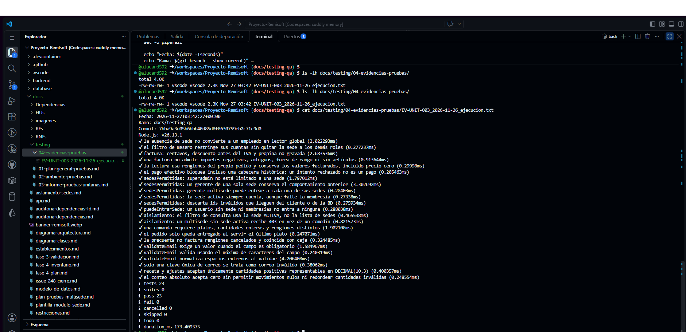

# Evidencias de pruebas — RemiSoft

## 1. Introducción

Este directorio contiene las evidencias obtenidas durante las actividades de aseguramiento de calidad del sistema RemiSoft.

Su finalidad es respaldar los resultados registrados en los informes de pruebas y facilitar la trazabilidad, reproducción y verificación de las actividades realizadas.

## 2. Objetivos

- Conservar registros verificables de las pruebas.
- Documentar los resultados obtenidos.
- Identificar la versión del software evaluada.
- Facilitar la reproducción de los casos de prueba.
- Respaldar los hallazgos registrados durante el proceso QA.

## 3. Evidencias de pruebas unitarias

| ID | Descripción | Estado |
|---|---|---|
| EV-UNIT-001 | Primera ejecución de los 23 casos unitarios | Resultados documentados en el informe |
| EV-UNIT-002 | Captura de pantalla del registro de la segunda ejecución | Pendiente de incorporar |
| EV-UNIT-003 | Registro textual completo de la segunda ejecución | Disponible |

### 3.1. Primera ejecución

| Indicador | Resultado |
|---|---|
| Fecha | 26/11/2026 |
| Rama | docs/testing-qa |
| Commit | f248e66 |
| Node.js | v26.13.1 |
| Pruebas ejecutadas | 23 |
| Pruebas aprobadas | 23 |
| Pruebas fallidas | 0 |
| Pruebas omitidas | 0 |
| Duración | 317.095116 ms |
| Aprobación | 100 % |

Los resultados individuales se encuentran documentados en el [Informe de pruebas unitarias](../03-informe-pruebas-unitarias.md).

### 3.2. Segunda ejecución

| Indicador | Resultado |
|---|---|
| Fecha local | 26/11/2026 |
| Hora local | 22:42:27 UTC-5 |
| Fecha y hora del servidor | 2026-11-27T03:42:27+00:00 |
| Rama | docs/testing-qa |
| Commit | 7bba9a3d05b6bbb40d85d8f8630759eb2c71c9d0 |
| Node.js | v26.13.1 |
| Pruebas ejecutadas | 23 |
| Pruebas aprobadas | 23 |
| Pruebas fallidas | 0 |
| Pruebas omitidas | 0 |
| Pruebas canceladas | 0 |
| Duración | 173.409375 ms |
| Aprobación | 100 % |

### 3.3. Registro de ejecución

El siguiente archivo contiene los resultados generados directamente mediante Node.js Test Runner:

[EV-UNIT-003 — Registro completo de ejecución](EV-UNIT-003_2026-11-26_ejecucion.txt)

El registro incluye la identificación del commit, la versión de Node.js, los resultados individuales y el resumen de ejecución.

### 3.4. Evidencia visual

La evidencia EV-UNIT-002 corresponde a una captura de pantalla de la consulta del registro EV-UNIT-003 mediante el comando `cat`.

**Figura 1.** Resultados de la segunda ejecución de pruebas unitarias: 23 casos aprobados, cero fallos y una duración total de 173.409375 ms.

Esta captura complementa el registro textual y no representa una ejecución adicional.

## 4. Comparación de resultados

| Área | Primera ejecución | Segunda ejecución |
|---|---:|---:|
| Validación de datos | 6/6 | 6/6 |
| Facturación | 4/4 | 4/4 |
| Gestión multisede | 8/8 | 8/8 |
| Servicio de salón | 3/3 | 3/3 |
| Establecimientos | 2/2 | 2/2 |
| **Total** | **23/23** | **23/23** |

Ambas ejecuciones presentan resultados satisfactorios para los mismos 23 casos unitarios.

No se contabilizan como 46 casos diferentes, debido a que corresponden a la repetición del mismo conjunto de pruebas.

## 5. Evidencias de configuración del ambiente QA

| ID | Evidencia | Estado |
|---|---|---|
| EV-ENV-001 | Validación estructural de Docker Compose QA | Realizada; registro independiente pendiente |
| EV-ENV-002 | Commit de configuración independiente | Disponible |
| EV-ENV-003 | Integración de la configuración en develop | Disponible |

Referencias:

- [Commit de configuración QA](https://github.com/Cesar10007/Proyecto-Remisoft/commit/f26013b).
- [Pull Request de integración QA #286](https://github.com/Cesar10007/Proyecto-Remisoft/pull/286).
- [Configuración Docker QA](https://github.com/Cesar10007/Proyecto-Remisoft/blob/5b86de5021451e8a2b0908739426bdb248686b68/docker-compose.qa.yml).

La validación operativa completa del ambiente Docker QA permanece pendiente de confirmación.

## 6. Evidencias de integración continua

| ID | Evidencia | Resultado |
|---|---|---|
| EV-CI-001 | CI asociado al Pull Request #286 | Ejecución exitosa |
| EV-CI-002 | Branch flow asociado al Pull Request #286 | Ejecución exitosa |

Referencias:

- [Ejecución CI](https://github.com/Cesar10007/Proyecto-Remisoft/actions/runs/45930257166).
- [Ejecución Branch flow](https://github.com/Cesar10007/Proyecto-Remisoft/actions/runs/45930257071).
- [Pull Request de integración continua #285](https://github.com/Cesar10007/Proyecto-Remisoft/pull/285).

Estos resultados corresponden a ejecuciones específicas y no representan necesariamente el estado de ejecuciones posteriores.

## 7. Evidencias de defectos

Durante una ejecución posterior de integración continua se observó un conflicto de escritura o bloqueo mutuo en una operación de base de datos.

| Elemento | Información |
|---|---|
| ID de evidencia | EV-DEF-001 |
| Componente | Pruebas de integración del backend |
| Archivo señalado | backend/tests/fixtures/establecimiento.js |
| Línea señalada | 21 |
| Error | Transaction failed due to a write conflict or a deadlock |
| Procedencia | Captura compartida durante la revisión del equipo |
| Estado | Pendiente de incorporar y verificar su resolución |

El hallazgo corresponde a una ejecución de integración continua, no a las pruebas unitarias documentadas en este directorio.

La causa exacta y el estado de corrección deberán confirmarse mediante pruebas adicionales.

## 8. Evidencias pendientes

- Validación operativa del ambiente Docker QA.
- Pruebas de integración.
- Pruebas funcionales.
- Pruebas de extremo a extremo.
- Cobertura de código.
- Mediciones de rendimiento.
- Evaluaciones de accesibilidad.
- Confirmación y regresión de defectos.
- Reproducción de las pruebas unitarias con Node.js 20.19.4.

## 9. Protección de la información

Las evidencias publicadas no deberán contener:

- Contraseñas.
- Tokens de autenticación.
- Secretos JWT.
- Credenciales de bases de datos.
- Credenciales SMTP.
- Datos personales de clientes reales.

Los registros deberán conservarse sin alterar los resultados originales.

## 10. Documentos relacionados

- [Plan General de Pruebas](../01-plan-general-pruebas.md).
- [Ambiente independiente de pruebas](../02-ambiente-pruebas.md).
- [Informe de pruebas unitarias](../03-informe-pruebas-unitarias.md).

## 11. Conclusión

Las evidencias recopiladas permiten respaldar la ejecución satisfactoria de 23 pruebas unitarias en dos ocasiones independientes.

Los resultados demuestran consistencia en las funciones evaluadas, sin fallos ni omisiones durante las ejecuciones registradas.

Las evidencias deberán complementarse con los resultados de integración, pruebas funcionales y demás verificaciones establecidas en el Plan General de Pruebas.
