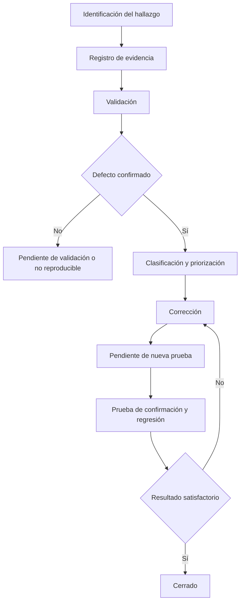
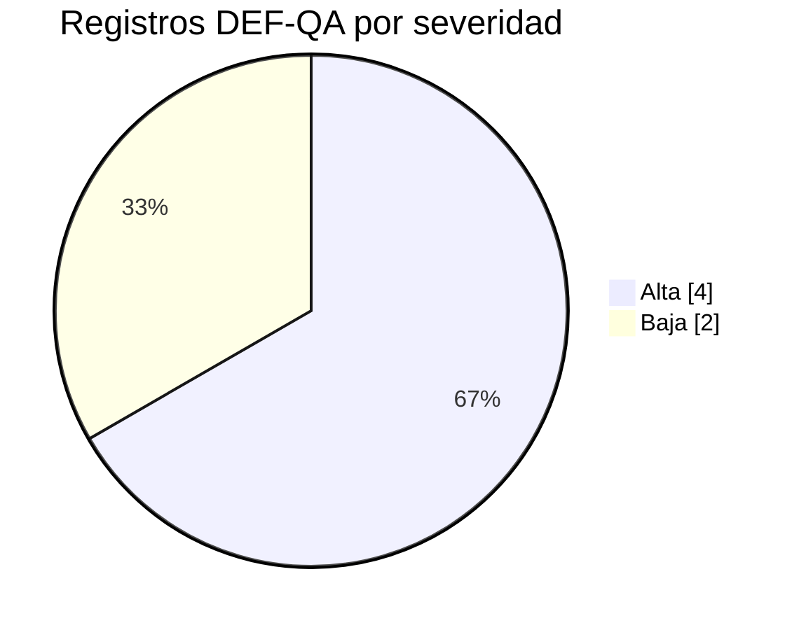
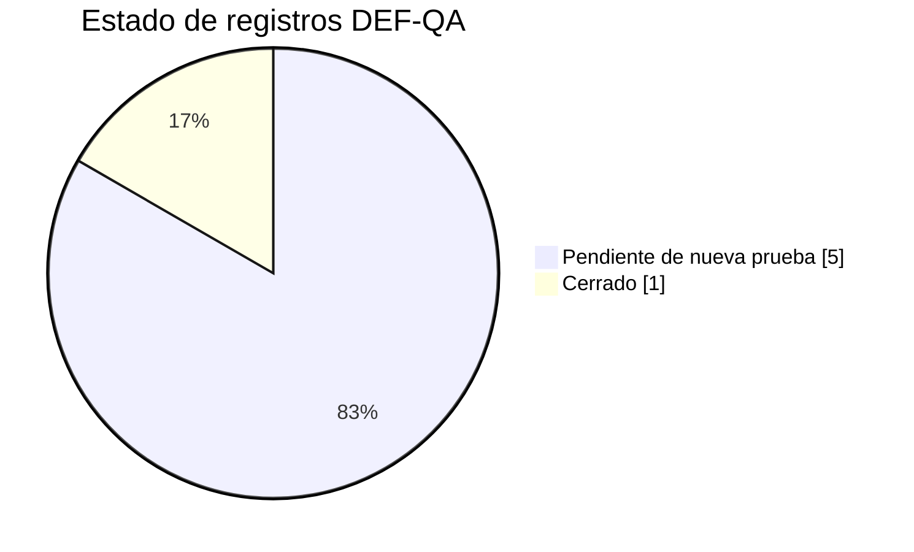

# Matriz de defectos y seguimiento QA — RemiSoft

## 1. Introducción

El presente documento registra los defectos, hallazgos técnicos y observaciones identificados durante las actividades de aseguramiento de calidad del sistema RemiSoft.

Su finalidad es facilitar la clasificación, seguimiento, corrección y verificación de los problemas detectados, manteniendo la trazabilidad con el código fuente, las pruebas ejecutadas y las evidencias disponibles.

La matriz complementa el registro histórico de defectos existente en el repositorio y se concentra en los hallazgos relacionados con las actividades recientes de QA.

## 2. Objetivo general

Gestionar los defectos y hallazgos identificados en RemiSoft mediante una clasificación basada en su severidad, prioridad, estado y evidencia disponible.

### 2.1. Objetivos específicos

- Identificar los componentes afectados.
- Clasificar los defectos según su impacto.
- Establecer prioridades de atención.
- Registrar las medidas correctivas identificadas.
- Facilitar la reproducción de los problemas.
- Mantener la trazabilidad con GitHub.
- Diferenciar los defectos confirmados de las observaciones pendientes.
- Facilitar las pruebas de regresión.
- Evitar el cierre de defectos sin evidencia suficiente.

## 3. Alcance y referencias

Fecha de consolidación: 26 de noviembre de 2026.

La matriz considera:

- Resultados de pruebas unitarias.
- Resultados de integración continua.
- Hallazgos reportados durante actividades anteriores de QA.
- Revisión estática del código fuente.
- Observaciones sobre requisitos no funcionales.
- Cambios incorporados mediante Pull Requests.
- Riesgos asociados al ambiente independiente de pruebas.

### 3.1. Documentos relacionados

- [Plan General de Pruebas](01-plan-general-pruebas.md).
- [Ambiente independiente de pruebas](02-ambiente-pruebas.md).
- [Informe de pruebas unitarias](03-informe-pruebas-unitarias.md).
- [Índice de evidencias](04-evidencias-pruebas/README.md).
- [Reporte de ejecución](05-reporte-ejecucion.md).

### 3.2. Registro histórico del equipo

El proyecto dispone adicionalmente del siguiente documento:

[Reporte histórico de ejecución y registro de defectos](https://github.com/Cesar10007/Proyecto-Remisoft/blob/develop/docs/04-reporte-ejecucion-pruebas.md).

La presente matriz no reemplaza dicho registro ni modifica sus identificadores.

Los defectos históricos deberán consultarse considerando la fecha en que fueron documentados y los cambios posteriores del sistema.

## 4. Clasificación de severidad

La clasificación corresponde a la sección 17 del Plan General de Pruebas.

| Severidad | Descripción |
|---|---|
| Crítica | Impide la operación del sistema, compromete gravemente los datos o genera pérdidas económicas importantes. |
| Alta | Afecta una funcionalidad esencial sin una alternativa operativa adecuada. |
| Media | Afecta parcialmente una funcionalidad, pero permite continuar operando. |
| Baja | Corresponde a problemas menores o visuales que no impiden el funcionamiento. |

Para los hallazgos de infraestructura y automatización, la severidad se interpreta considerando su impacto sobre el proceso de validación y entrega del software.

Una falla de automatización no implica necesariamente un defecto funcional del producto.

## 5. Clasificación de prioridad

| Prioridad | Descripción |
|---|---|
| Alta | Requiere atención prioritaria antes de la entrega. |
| Media | Debe corregirse dentro de una iteración planificada. |
| Baja | Puede programarse para una versión posterior. |

La severidad representa el impacto del defecto, mientras que la prioridad establece el orden recomendado de atención.

Las prioridades podrán ajustarse durante la revisión técnica del equipo.

## 6. Estados de seguimiento

| Estado | Descripción |
|---|---|
| Pendiente de validación | El hallazgo requiere comprobación adicional. |
| Abierto | El defecto fue identificado y requiere corrección. |
| Asignado | El defecto fue asignado para su atención. |
| En corrección | Se encuentra en proceso de solución. |
| Pendiente de nueva prueba | Existe una medida correctiva que requiere verificación adicional. |
| Cerrado | La resolución cuenta con evidencia suficiente para el alcance del defecto. |
| Reabierto | El defecto volvió a presentarse después de su cierre. |
| Rechazado o no reproducible | El hallazgo no corresponde a un defecto confirmado o no pudo reproducirse. |
| Diferido | Su atención fue pospuesta mediante una decisión del equipo. |

Los estados registrados en esta matriz corresponden al seguimiento técnico y no representan necesariamente los estados administrativos de las issues de GitHub.

## 7. Flujo de gestión de defectos





## 8. Identificación de registros

Se utilizan los siguientes prefijos:

| Prefijo | Finalidad |
|---|---|
| DEF-QA | Defectos y hallazgos técnicos relacionados con QA. |
| OBS-QA | Observaciones pendientes de comprobación. |
| RSK-QA | Riesgos técnicos identificados durante la revisión. |

Los identificadores son internos de esta matriz y no sustituyen los números de issues o Pull Requests de GitHub.

## 9. Matriz consolidada de defectos

| ID | Componente | Descripción | Tipo | Severidad | Prioridad | Estado |
|---|---|---|---|---|---|---|
| DEF-QA-001 | Reportes | Referencia a la variable esMesero sin definición. | Producto | Alta | Alta | Pendiente de nueva prueba |
| DEF-QA-002 | Base de datos | Vista de ventas diarias sin id_restaurante. | Producto | Alta | Alta | Pendiente de nueva prueba |
| DEF-QA-003 | Pruebas de aislamiento | Diferencia entre la estructura de respuesta de ingredientes y la esperada por la prueba. | Automatización | Baja | Media | Pendiente de nueva prueba |
| DEF-QA-004 | Datos de prueba | Generación de direcciones de correo inválidas en fixtures. | Automatización | Baja | Media | Pendiente de nueva prueba |
| DEF-QA-005 | Integración continua | Preparación incompleta de la base de datos por ausencia de vistas y procedimientos almacenados. | Infraestructura | Alta | Alta | Cerrado |
| DEF-QA-006 | Pruebas de integración | Conflicto de escritura o bloqueo mutuo durante operaciones de base de datos. | Automatización | Alta | Alta | Pendiente de nueva prueba |

Las severidades y prioridades representan una clasificación técnica propuesta de acuerdo con el impacto identificado.

El cierre de DEF-QA-005 se limita a la preparación de la base de datos dentro de las ejecuciones CI verificadas.

## 10. Registro detallado de defectos

### 10.1. DEF-QA-001 — Variable indefinida en reportes

| Campo | Información |
|---|---|
| Identificador | DEF-QA-001 |
| Componente | Backend — Reportes |
| Archivo relacionado | backend/src/controllers/reportes.controller.js |
| Caso de prueba asociado | Consulta de reportes de ventas |
| Severidad | Alta |
| Prioridad | Alta |
| Estado | Pendiente de nueva prueba |
| Procedencia | Hallazgo reportado en actividades anteriores de QA |
| Commit exacto de detección | No confirmado mediante registro original |
| Referencia de corrección | PR #285 |

**Descripción**

Durante actividades anteriores de pruebas se reportó un error relacionado con el uso de una variable denominada esMesero que no se encontraba definida en el contexto correspondiente.

El problema podía provocar una respuesta HTTP 500 durante la consulta afectada.

**Resultado esperado**

El sistema debe generar el reporte solicitado de acuerdo con los permisos y el establecimiento correspondiente, sin producir excepciones internas.

**Resultado obtenido históricamente**

Se reportó un error interno relacionado con una referencia no definida.

**Procedimiento propuesto de confirmación**

1. Preparar un ambiente aislado de pruebas.
2. Autenticarse con un usuario autorizado para consultar reportes.
3. Registrar datos de ventas controlados.
4. Solicitar el reporte de ventas correspondiente.
5. Verificar el código HTTP y los datos devueltos.
6. Confirmar que no se produzcan errores relacionados con esMesero.

**Medida correctiva identificada**

El PR #285 eliminó fragmentos residuales de una integración de código en la consulta de productos más vendidos, incluidas las referencias problemáticas a esMesero, conservando la consulta que aplica el aislamiento por establecimiento.

**Evidencia**

[Pull Request #285](https://github.com/Cesar10007/Proyecto-Remisoft/pull/285).

El registro original del fallo no se encuentra incorporado a las evidencias actuales.

La corrección requiere una prueba específica de confirmación.

### 10.2. DEF-QA-002 — Vista de ventas diarias sin identificador de restaurante

| Campo | Información |
|---|---|
| Identificador | DEF-QA-002 |
| Componente | Base de datos — Reportes |
| Archivo relacionado | database/vistas/vista_resumen_ventas_diarias.sql |
| Caso de prueba asociado | Consulta de ventas filtrada por establecimiento |
| Severidad | Alta |
| Prioridad | Alta |
| Estado | Pendiente de nueva prueba |
| Procedencia | Hallazgo reportado en actividades anteriores de QA |
| Commit exacto de detección | No confirmado mediante registro original |
| Referencia de corrección | PR #285 |

**Descripción**

Se reportó una inconsistencia en la vista de resumen de ventas diarias relacionada con la ausencia del identificador id_restaurante.

Esta situación podía afectar las consultas que requieren filtrar los resultados por establecimiento.

**Resultado esperado**

La vista debe permitir recuperar los resultados correspondientes a cada establecimiento, respetando el aislamiento de los datos.

**Resultado obtenido históricamente**

Se reportó un error asociado a la consulta de una columna no disponible en la vista.

**Procedimiento propuesto de confirmación**

1. Inicializar una base de datos aislada.
2. Aplicar las migraciones correspondientes.
3. Cargar las vistas SQL.
4. Crear ventas en dos establecimientos diferentes.
5. Consultar el resumen de ventas de cada establecimiento.
6. Verificar la disponibilidad de id_restaurante.
7. Confirmar que los resultados no mezclen información entre establecimientos.

**Medida correctiva identificada**

El PR #285 corrigió la definición SQL de la vista de ventas diarias, eliminando una consulta anterior incompatible y conservando la consulta que incorpora id_restaurante y la agrupación por establecimiento.

**Evidencia**

[Pull Request #285](https://github.com/Cesar10007/Proyecto-Remisoft/pull/285).

La validación específica de los resultados de ventas por establecimiento permanece pendiente.

### 10.3. DEF-QA-003 — Estructura de respuesta de ingredientes

| Campo | Información |
|---|---|
| Identificador | DEF-QA-003 |
| Componente | Pruebas automatizadas de aislamiento |
| Archivo relacionado | backend/tests/aislamiento-sedes.integration.test.js |
| Caso de prueba asociado | Consulta de ingredientes por establecimiento |
| Severidad | Baja |
| Prioridad | Media |
| Estado | Pendiente de nueva prueba |
| Procedencia | Hallazgo reportado en actividades anteriores de QA |
| Commit exacto de detección | No confirmado mediante registro original |
| Referencia de corrección | PR #285 |

**Descripción**

Se reportó una diferencia entre la estructura de respuesta devuelta por el endpoint de ingredientes y la estructura esperada por la prueba automatizada.

La prueba esperaba una estructura con una propiedad data, mientras que el comportamiento reportado correspondía a un arreglo.

**Resultado esperado**

La prueba debe verificar la estructura definida en el contrato de la API y comprobar el aislamiento de ingredientes entre establecimientos.

**Resultado obtenido históricamente**

Se reportó una aserción fallida debido a la diferencia de estructuras.

**Procedimiento propuesto de confirmación**

1. Revisar el contrato vigente del endpoint de ingredientes.
2. Preparar datos de prueba en dos establecimientos.
3. Ejecutar el archivo de pruebas de aislamiento.
4. Comparar la respuesta real con el contrato de la API.
5. Confirmar que las pruebas comprueben el aislamiento de datos.

**Medida correctiva identificada**

El PR #285 modificó las pruebas correspondientes a la consulta de ingredientes.

**Evidencia**

[Pull Request #285](https://github.com/Cesar10007/Proyecto-Remisoft/pull/285).

La clasificación inicial corresponde a un problema de automatización.

Si el contrato de la API establece una estructura diferente de la devuelta por el endpoint, deberá evaluarse adicionalmente como defecto funcional.

### 10.4. DEF-QA-004 — Correo inválido en datos de prueba

| Campo | Información |
|---|---|
| Identificador | DEF-QA-004 |
| Componente | Fixtures de establecimientos |
| Archivo relacionado | backend/tests/fixtures/establecimiento.js |
| Caso de prueba asociado | Creación automatizada de gerentes |
| Severidad | Baja |
| Prioridad | Media |
| Estado | Pendiente de nueva prueba |
| Procedencia | Hallazgo reportado en actividades anteriores de QA |
| Commit exacto de detección | No confirmado mediante registro original |
| Referencia de corrección | PR #285 |

**Descripción**

Se reportó la generación de direcciones de correo inválidas cuando los datos utilizados para crear gerentes incluían nombres con espacios.

El problema afectaba la preparación de determinados escenarios de integración.

**Resultado esperado**

Los fixtures deben generar direcciones de correo válidas y diferenciadas para los usuarios de prueba.

**Resultado obtenido históricamente**

Se reportó el rechazo de datos generados durante la preparación de pruebas.

**Procedimiento propuesto de confirmación**

1. Preparar un ambiente aislado.
2. Ejecutar un escenario de creación de gerentes con nombres que contengan espacios.
3. Verificar los correos generados.
4. Confirmar la creación satisfactoria de los usuarios de prueba.
5. Comprobar que no existan colisiones entre los correos generados.

**Medida correctiva identificada**

La configuración actual utiliza una estructura de correo basada en un índice y una etiqueta de prueba:

```javascript
const email = `gerente-${sedes.length + 1}-${tag}@example.test`;
```

Esta estructura evita utilizar directamente el nombre del gerente para formar la dirección de correo.

**Evidencia**

- [Pull Request #285](https://github.com/Cesar10007/Proyecto-Remisoft/pull/285).
- [Fixture de establecimientos](https://github.com/Cesar10007/Proyecto-Remisoft/blob/develop/backend/tests/fixtures/establecimiento.js).

El cambio fue identificado mediante revisión del repositorio.

Se mantiene pendiente la confirmación individual del escenario reportado.

### 10.5. DEF-QA-005 — Preparación incompleta de la base de datos CI

| Campo | Información |
|---|---|
| Identificador | DEF-QA-005 |
| Componente | GitHub Actions |
| Archivo relacionado | .github/workflows/ci.yml |
| Caso de prueba asociado | Preparación de base de datos y ejecución general |
| Severidad | Alta |
| Prioridad | Alta |
| Estado | Cerrado |
| Procedencia | Revisión técnica de configuración y antecedentes de integración |
| Commit exacto de detección | No confirmado |
| Referencia de corrección | PR #285 |

**Descripción**

La preparación de una base de datos de pruebas únicamente mediante migraciones podía resultar insuficiente para las funcionalidades dependientes de vistas y procedimientos almacenados.

**Resultado esperado**

El ambiente CI debe preparar la estructura necesaria para ejecutar las pruebas de integración sin omitir dependencias SQL requeridas.

**Resultado obtenido históricamente**

Se reportaron fallos asociados a la preparación incompleta de los recursos de base de datos.

**Medida correctiva identificada**

El PR #285 incorporó:

- Servicio MariaDB para pruebas.
- Base de datos temporal remisoft_test.
- Ejecución de migraciones Prisma.
- Generación de Prisma Client.
- Carga de vistas SQL.
- Carga de procedimientos almacenados.
- Activación de variables de integración.

**Verificación**

Los registros de GitHub Actions consultados confirman la ejecución satisfactoria de la preparación de la base de datos y del conjunto general de pruebas del backend.

| Ejecución | Aprobadas | Fallidas | Omitidas |
|---|---:|---:|---:|
| CI del PR #286 | 88 | 0 | 0 |
| CI del PR #290 | 88 | 0 | 0 |

**Evidencias**

- [Pull Request #285](https://github.com/Cesar10007/Proyecto-Remisoft/pull/285).
- [CI del PR #286](https://github.com/Cesar10007/Proyecto-Remisoft/actions/runs/45930257166).
- [CI del PR #290](https://github.com/Cesar10007/Proyecto-Remisoft/actions/runs/45935608011).

**Justificación del cierre**

La medida correctiva se encuentra incorporada y existen ejecuciones CI satisfactorias que incluyen la preparación de la base de datos.

El cierre corresponde exclusivamente al hallazgo de preparación incompleta de CI y no certifica el funcionamiento operativo del ambiente Docker QA ni de todos los recursos SQL de forma individual.

### 10.6. DEF-QA-006 — Conflicto de transacciones en integración

| Campo | Información |
|---|---|
| Identificador | DEF-QA-006 |
| Componente | Pruebas de integración del backend |
| Archivo señalado | backend/tests/fixtures/establecimiento.js |
| Línea señalada | 21 |
| Caso de prueba asociado | Preparación o limpieza de datos de establecimientos |
| Severidad | Alta |
| Prioridad | Alta |
| Estado | Pendiente de nueva prueba |
| Procedencia | Captura compartida durante la revisión del equipo |
| Commit exacto de detección | No confirmado |
| Evidencia asociada | EV-DEF-001 |

**Descripción**

Durante una ejecución de integración continua se observó el siguiente error:

```text
Transaction failed due to a write conflict or a deadlock.
Please retry your transaction.
```

El mensaje indica un conflicto de escritura o bloqueo mutuo durante una operación de base de datos.

El origen exacto del conflicto requiere confirmación adicional.

**Resultado esperado**

Las pruebas de integración deben ejecutarse de forma estable, incluyendo las operaciones de preparación y limpieza de datos.

**Resultado obtenido**

Se observó un error de transacción durante una ejecución de pruebas de integración.

No se dispone del registro completo de dicha ejecución para establecer su resultado final.

**Hipótesis técnica**

La ejecución concurrente de archivos de pruebas que utilizan recursos compartidos de base de datos constituye una posible causa del conflicto.

Esta hipótesis no se considera una causa raíz demostrada.

**Medida correctiva identificada**

El archivo package.json del backend contiene actualmente:

```json
"test": "node --test --test-concurrency=1"
```

Esta modificación limita a uno la concurrencia entre archivos de prueba.

**Resultado posterior verificado**

La ejecución CI del PR #290 registró:

- 88 pruebas contabilizadas.
- 88 pruebas aprobadas.
- 0 pruebas fallidas.
- 0 pruebas omitidas.
- Duración de 48731.497501 ms.

**Procedimiento propuesto de regresión**

1. Preparar una base de datos de pruebas aislada.
2. Confirmar la versión del código evaluado.
3. Ejecutar el conjunto de pruebas con concurrencia limitada.
4. Conservar los registros de ejecución.
5. Repetir el proceso para evaluar la estabilidad.
6. Verificar que no se produzcan conflictos de transacciones.
7. Confirmar la limpieza de los datos de prueba.

**Evidencias**

- [Configuración del ejecutor](https://github.com/Cesar10007/Proyecto-Remisoft/blob/29e54d864b9a5fc804c11d07089bf9dc2efc8db7/backend/package.json).
- [CI del PR #290](https://github.com/Cesar10007/Proyecto-Remisoft/actions/runs/45935608011).

**Justificación del estado**

La ejecución exitosa posterior constituye evidencia favorable.

Sin embargo, no demuestra por sí sola que la causa raíz haya sido eliminada definitivamente.

Se mantiene pendiente de nueva prueba para evaluar la estabilidad de la solución.

## 11. Seguimiento de defectos históricos

### 11.1. Issue #248 — Desalineación del esquema de datos

| Campo | Información |
|---|---|
| Identificador original | Issue #248 |
| Identificador histórico | DEF-06 |
| Componente | Prisma y MariaDB |
| Error histórico | P2022 |
| Severidad según clasificación QA actual | Crítica |
| Estado administrativo en GitHub | Cerrado |
| Fecha de cierre | 25/11/2026 |
| Motivo de cierre | Completado |
| Referencia de corrección | PR #283 |
| Nueva regresión específica en esta sesión | Pendiente |

**Descripción**

El esquema Prisma declaraba la columna id_restaurante en siete tablas donde la columna no existía inicialmente en la base de datos.

Las tablas afectadas eran:

- caja.
- inventario_mov.
- lote_ingrediente.
- orden_compra.
- pedido.
- proveedor.
- turno_caja.

El problema provocaba errores en consultas relacionadas con pedidos, domicilios, proveedores, cajas y turnos.

**Corrección documentada**

El documento de cierre del equipo registra la incorporación de las columnas, índices y relaciones correspondientes mediante migraciones.

También documenta verificaciones relacionadas con el esquema, las rutas y las pruebas automatizadas.

**Estado**

El cierre de la issue fue confirmado directamente en GitHub.

No se afirma que durante las actividades actuales se haya realizado nuevamente toda la regresión específica.

**Referencias**

- [Issue #248](https://github.com/Cesar10007/Proyecto-Remisoft/issues/248).
- [Pull Request #283](https://github.com/Cesar10007/Proyecto-Remisoft/pull/283).
- [Justificación de cierre del issue #248](https://github.com/Cesar10007/Proyecto-Remisoft/blob/develop/docs/issue-248-cierre.md).

Este defecto se conserva como referencia histórica y no se contabiliza nuevamente dentro de los seis registros DEF-QA de la presente matriz.

## 12. Matriz de observaciones sobre requisitos no funcionales

Las siguientes observaciones corresponden a criterios pendientes de evaluación o confirmación.

No se contabilizan como defectos confirmados.

| ID | Requisito | Criterio | Observación | Prioridad | Estado |
|---|---|---|---|---|---|
| OBS-QA-001 | RNF-005.1 | Generación del CUFE | No se identificó lógica completa de generación durante la revisión del equipo. | Alta | Pendiente de validación |
| OBS-QA-002 | RNF-005.2 | Almacenamiento de facturas XML | No se identificó la implementación completa durante la revisión del equipo. | Alta | Pendiente de validación |
| OBS-QA-003 | RNF-002.2 | Pool entre 2 y 10 conexiones | No se dispone de evidencia sobre los límites efectivos de conexiones. | Media | Pendiente de validación |
| OBS-QA-004 | RNF-003.1 | Cobertura mínima del 80 % en lógica crítica | No se dispone de un reporte actualizado de cobertura. | Alta | Pendiente de validación |
| OBS-QA-005 | RNF-002.1 | Inicio de sesión inferior a 500 ms | No se dispone de mediciones controladas. | Alta | Pendiente de validación |
| OBS-QA-006 | RNF-002.3 | Carga inicial inferior a 3 segundos con conexión de 10 Mbps | No se dispone de mediciones bajo las condiciones establecidas. | Media | Pendiente de validación |
| OBS-QA-007 | RNF-002.4 | Predicciones de demanda inferiores a 2 segundos | Se requiere confirmar la implementación y medir el servicio. | Media | Pendiente de validación |
| OBS-QA-008 | RNF-004.2 | Contraste mínimo de 4.5:1 | No se dispone de una evaluación completa del contraste. | Media | Pendiente de validación |

### 12.1. Verificaciones propuestas

| Identificador | Actividad de validación |
|---|---|
| OBS-QA-001 | Inspeccionar el proceso de facturación electrónica y comprobar la generación del CUFE. |
| OBS-QA-002 | Verificar la generación, almacenamiento y recuperación de facturas XML. |
| OBS-QA-003 | Revisar la configuración del adaptador MariaDB y medir el comportamiento del pool. |
| OBS-QA-004 | Generar un reporte de cobertura de controladores y servicios críticos. |
| OBS-QA-005 | Medir el tiempo de respuesta del endpoint de autenticación. |
| OBS-QA-006 | Medir la carga inicial del frontend bajo una conexión controlada de 10 Mbps. |
| OBS-QA-007 | Confirmar la disponibilidad del servicio de predicción y medir su tiempo de respuesta. |
| OBS-QA-008 | Evaluar el contraste mediante herramientas de accesibilidad. |

La existencia de un criterio de aceptación no implica que este se encuentre implementado o verificado.

Cuando se confirme un incumplimiento, deberá registrarse como defecto con la evidencia correspondiente.

## 13. Riesgos técnicos

| ID | Riesgo | Impacto potencial | Prioridad | Medida recomendada |
|---|---|---|---|---|
| RSK-QA-001 | Diferencia entre las versiones de Node.js utilizadas en Codespaces y CI. | Resultados no completamente equivalentes. | Media | Reproducir las pruebas con Node.js 20.19.4. |
| RSK-QA-002 | Docker QA pendiente de validación operativa. | Fallos de arranque o configuración todavía no identificados. | Alta | Realizar una ejecución controlada y autorizada. |
| RSK-QA-003 | El ejecutor Docker QA utiliza directamente node --test. | Posibles conflictos de concurrencia. | Alta | Verificar y evaluar la alineación con el ejecutor secuencial del backend. |
| RSK-QA-004 | Cambios frecuentes en develop. | Desactualización de resultados y documentación. | Media | Asociar las pruebas a commits y realizar regresión. |
| RSK-QA-005 | Evidencias originales de determinados hallazgos históricos no disponibles. | Limitación de trazabilidad y reproducción. | Media | Recuperar los registros originales o generar nuevas evidencias. |

El riesgo RSK-QA-003 se identificó mediante revisión estática de docker-compose.qa.yml.

No representa un conflicto reproducido dentro del ambiente Docker QA.

## 14. Resumen de defectos por severidad

| Severidad | Cantidad |
|---|---:|
| Crítica | 0 |
| Alta | 4 |
| Media | 0 |
| Baja | 2 |
| **Total** | **6** |



La distribución corresponde únicamente a los seis registros DEF-QA.

El issue histórico #248, las observaciones de requisitos y los riesgos técnicos no se incluyen en esta distribución.

## 15. Resumen de defectos por estado

| Estado | Cantidad |
|---|---:|
| Pendiente de nueva prueba | 5 |
| Cerrado | 1 |
| **Total** | **6** |



Los cinco registros pendientes de nueva prueba cuentan con cambios correctivos identificados, pero requieren confirmación específica o comprobaciones adicionales.

Esta distribución no representa el total de defectos existentes en RemiSoft.

## 16. Resumen de registros por tipo

| Tipo de registro | Cantidad |
|---|---:|
| Defectos o hallazgos del producto | 2 |
| Defectos o hallazgos de automatización | 3 |
| Defectos o hallazgos de infraestructura | 1 |
| Observaciones sobre requisitos | 8 |
| Riesgos técnicos | 5 |

Adicionalmente, se conserva la referencia histórica al issue #248 sin duplicar su contabilización.

No se suman las observaciones y riesgos al total de defectos confirmados.

## 17. Trazabilidad de las correcciones

| Registro | Referencia | Cambio relacionado | Verificación pendiente |
|---|---|---|---|
| DEF-QA-001 | PR #285 | Controlador de reportes | Consulta específica de ventas |
| DEF-QA-002 | PR #285 | Vista SQL de ventas diarias | Aislamiento de resultados por sede |
| DEF-QA-003 | PR #285 | Pruebas de aislamiento | Confirmación del contrato de respuesta |
| DEF-QA-004 | PR #285 | Generación de correos en fixtures | Escenario con nombres que contienen espacios |
| DEF-QA-005 | PR #285 | Preparación SQL en CI | Seguimiento ordinario |
| DEF-QA-006 | package.json y CI del PR #290 | Ejecución secuencial | Repetición controlada de pruebas |
| Issue #248 | PR #283 | Migraciones de esquema | Nueva regresión específica en esta sesión |

Los registros DEF-QA no tienen necesariamente una issue individual asignada en GitHub.

La asignación de responsables y la creación de nuevas issues deberán realizarse mediante coordinación del equipo.

## 18. Pruebas de confirmación y regresión

Para verificar una corrección se deberá:

1. Identificar el defecto correspondiente.
2. Registrar la rama y el commit evaluados.
3. Preparar un ambiente independiente.
4. Reproducir el escenario original cuando sea posible.
5. Ejecutar el caso después de la corrección.
6. Comparar el resultado esperado con el obtenido.
7. Ejecutar pruebas de regresión relacionadas.
8. Conservar las evidencias.
9. Actualizar el estado del defecto.
10. Reabrir el defecto si el problema vuelve a presentarse.

Las pruebas deberán realizarse sin utilizar datos reales ni afectar el ambiente principal del proyecto.

## 19. Criterios para el cierre de defectos

Un defecto podrá cerrarse cuando:

- La medida correctiva se encuentre identificada.
- Se disponga de evidencia verificable.
- La prueba de confirmación resulte satisfactoria.
- Se evalúe el impacto sobre funcionalidades relacionadas.
- No se identifiquen nuevas fallas atribuibles a la corrección.
- Se actualice el registro de seguimiento.

Cuando la corrección corresponda a infraestructura, la verificación deberá demostrar el funcionamiento del control técnico afectado.

El cierre de un Pull Request no equivale automáticamente al cierre de todos los defectos relacionados.

## 20. Protección de la información

La documentación y las evidencias no deberán contener:

- Contraseñas.
- Credenciales de bases de datos.
- Secretos JWT.
- Tokens de autenticación.
- Credenciales SMTP.
- Información personal de clientes reales.

Los datos utilizados para reproducir defectos deberán corresponder a un ambiente independiente de pruebas.

## 21. Limitaciones

- No se dispone de los registros originales completos de todos los hallazgos históricos.
- No se reprodujeron individualmente todos los defectos durante la sesión actual.
- Los resultados CI consultados corresponden a ejecuciones específicas.
- La validación operativa independiente de Docker QA permanece pendiente.
- Las prioridades y severidades propuestas podrán ajustarse mediante revisión del equipo.
- Las observaciones sobre requisitos no constituyen automáticamente incumplimientos confirmados.
- No se realizó una auditoría integral de seguridad.
- La matriz no representa un inventario exhaustivo de todos los defectos del proyecto.

## 22. Conclusión

La matriz permite consolidar el seguimiento de seis defectos y hallazgos técnicos relacionados con las actividades recientes de aseguramiento de calidad de RemiSoft.

Se identificaron medidas correctivas incorporadas al repositorio y ejecuciones satisfactorias de integración continua.

Cinco registros permanecen pendientes de nueva prueba, mientras que el hallazgo asociado a la preparación de la base de datos de CI se considera cerrado dentro del alcance evaluado.

Adicionalmente, se registraron ocho observaciones sobre requisitos no funcionales y cinco riesgos técnicos que deberán ser atendidos mediante actividades de validación y seguimiento.

Los resultados permiten mantener una gestión trazable de los hallazgos sin confundir las correcciones implementadas con las verificaciones efectivamente realizadas.

El proceso continuará mediante pruebas de confirmación, regresión y actualización de evidencias, preservando la estabilidad del sistema y la independencia del ambiente QA.
